<p align="center"><a href="https://github.com/xUmutKx/Pulse/releases/latest"></a></p>

### Pulse

| Pulse keyboard settings | BlackOut | Buds manager | System font | Windows 11 look: flyout |
|---|---|---|---|---|
| 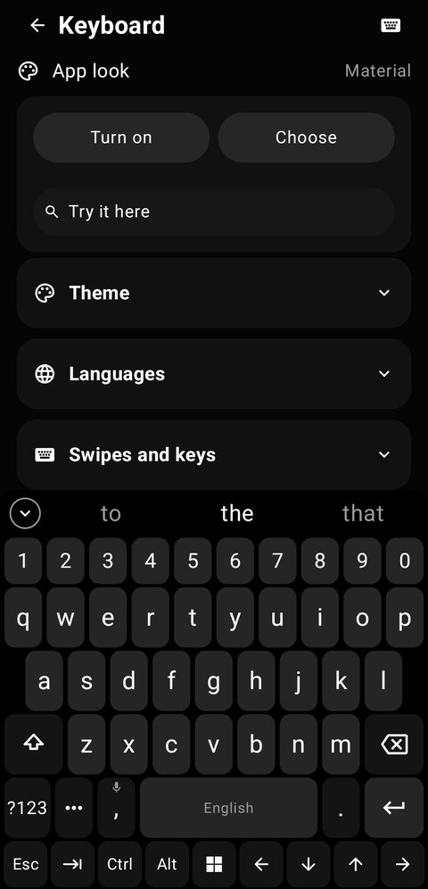 | 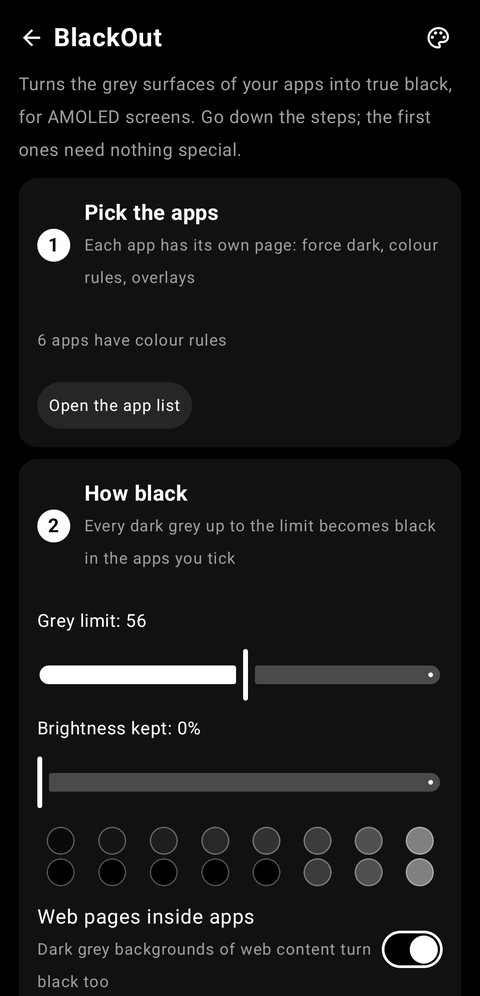 | 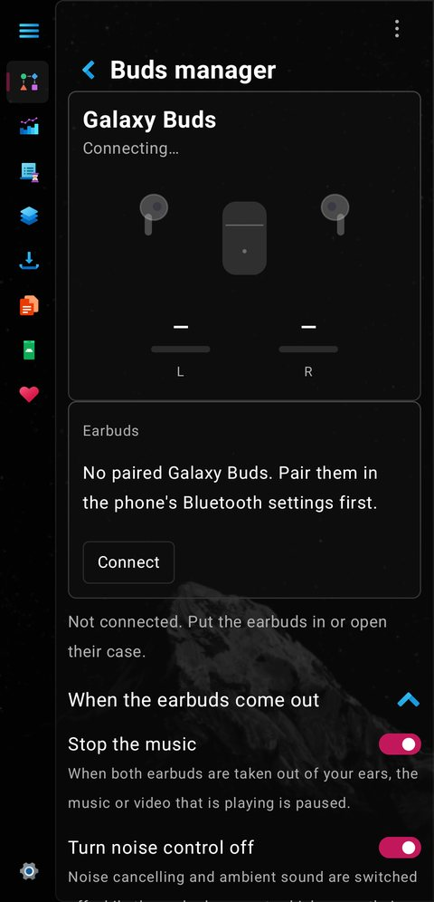 | 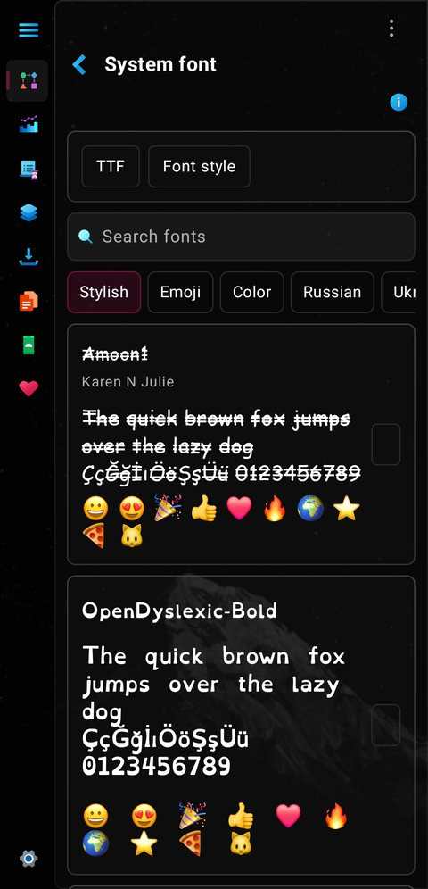 | 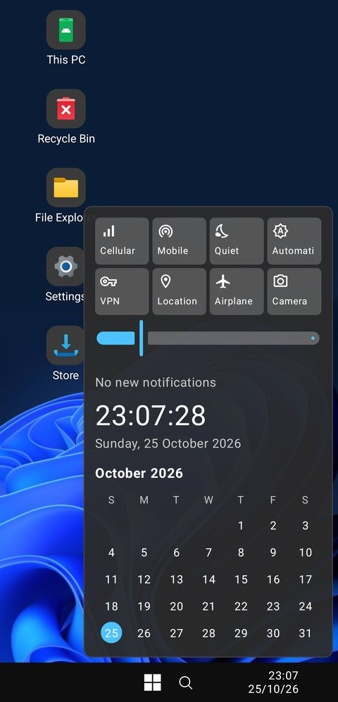 |

| Windows 11 look: desktop | Calculator | Weather | Files | Music player |
|---|---|---|---|---|
| 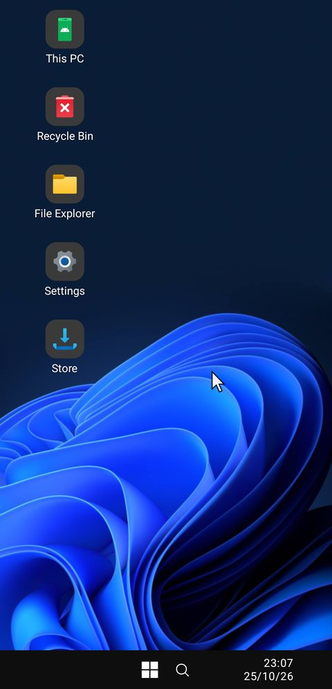 | 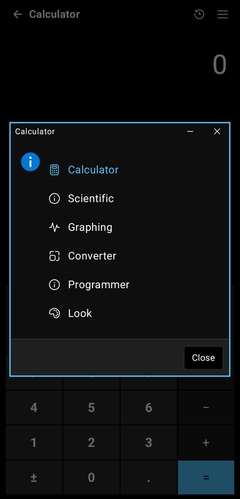 | 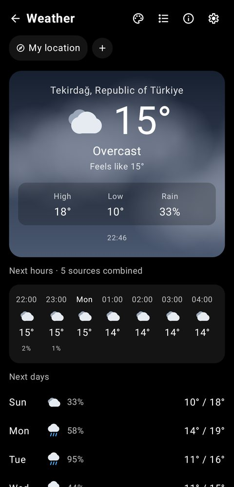 | 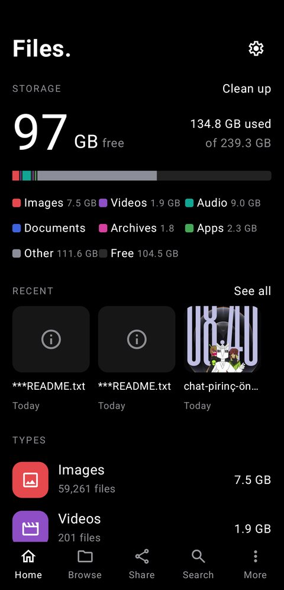 | 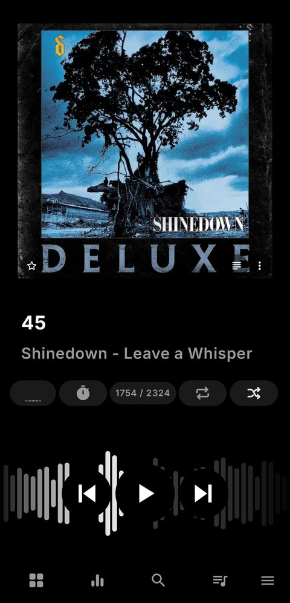 |

### More screenshots

| Processes | Performance | Overview | CPU cores | Windows 95 Performance |
|---|---|---|---|---|
| 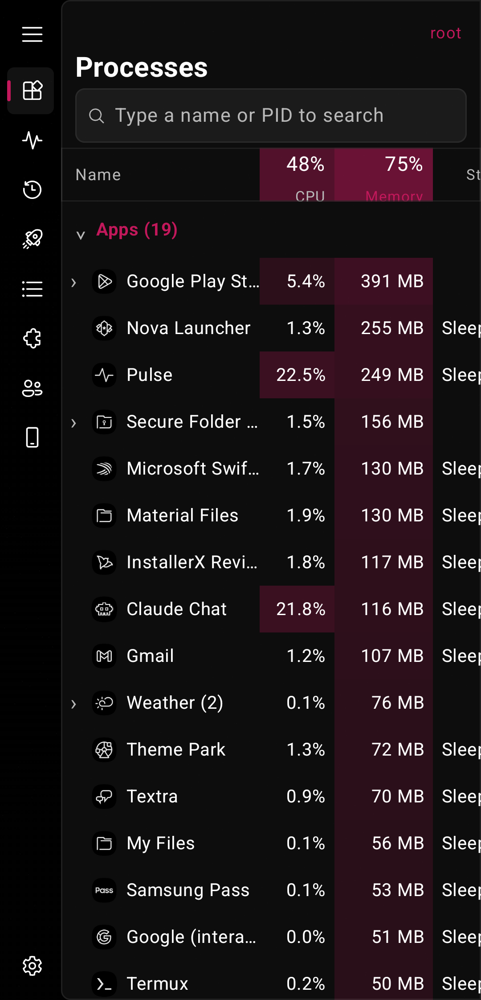 | 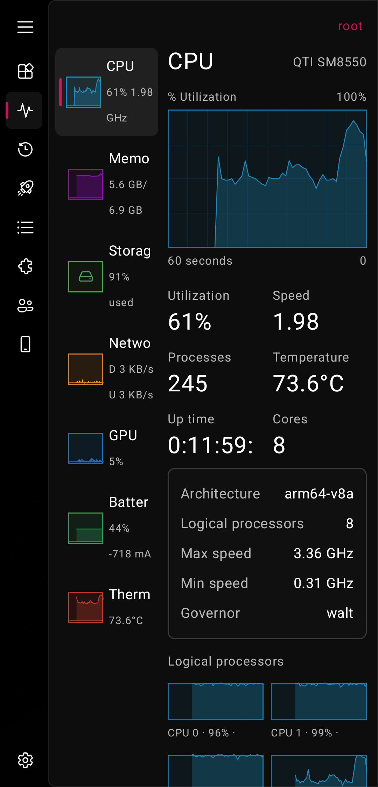 | 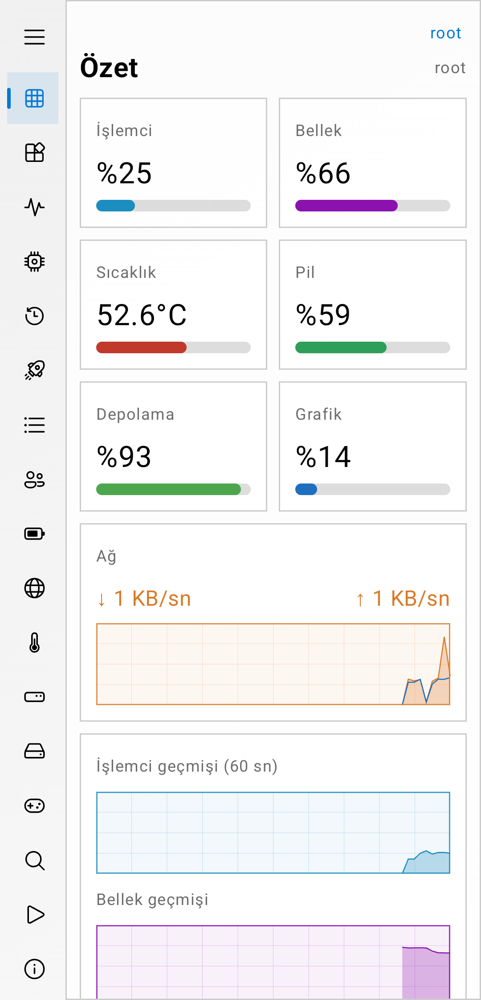 | 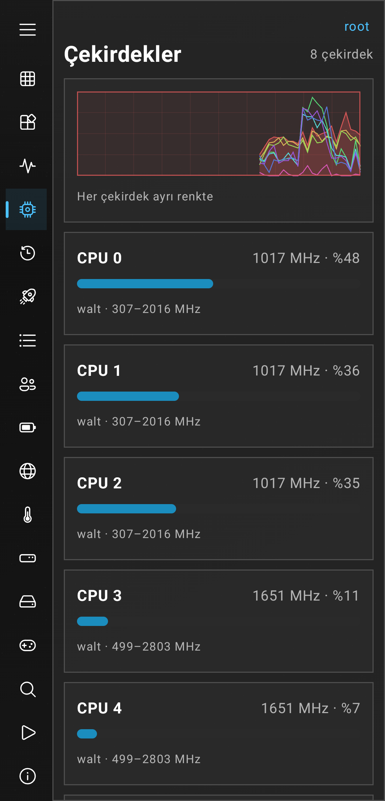 | 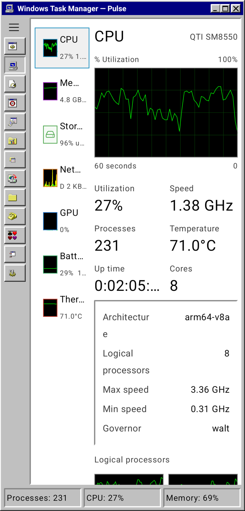 |

| Windows 7 Startup apps | Windows XP widgets | Windows 7 gadgets | App manager |
|---|---|---|---|
| 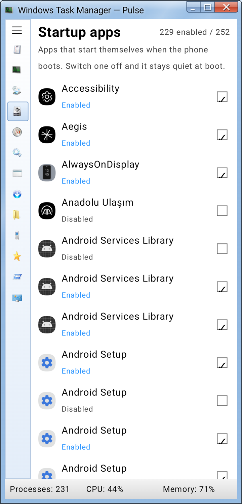 | 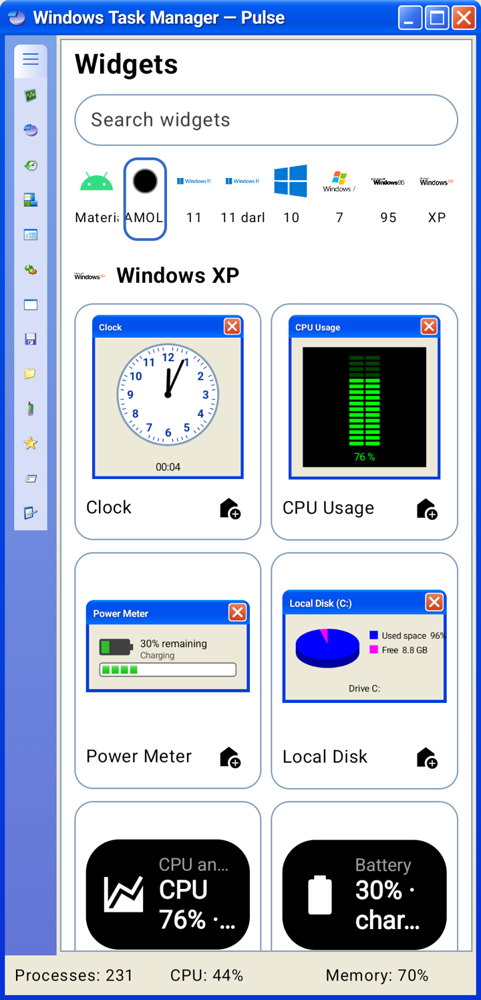 | 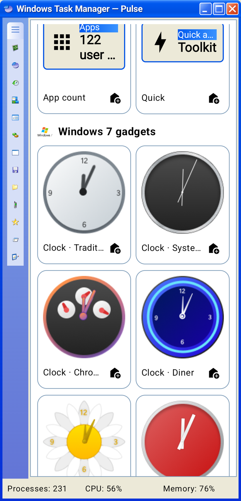 | 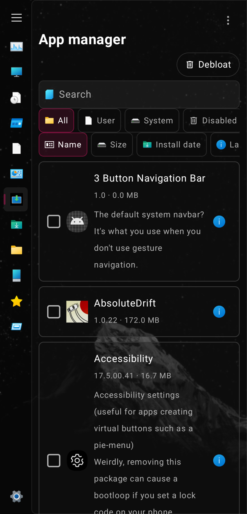 |


**An all-in-one toolbox for Android, in the style of Windows or Material.** Pulse is a task manager that shows live CPU, memory, storage, network, battery and temperature, and it has tools for the rest of the phone: a file explorer, an APK installer, a downloads manager, an app manager with a debloater, home-screen widgets, a terminal and a toolkit of small utilities.

Two downloads per release: `Pulse-<version>.apk` for Android 12 and newer, and `Pulse-<version>-android5.apk` for Android 5 and newer. Both hold the 64-bit ARM (arm64-v8a), 32-bit ARM (armeabi-v7a) and x86_64 libraries, so they install on phones, tablets and emulators of those kinds.


### Everything in Pulse, by category

<details><summary><b>Looks and Windows</b>: Windows 95, XP, 7, 10, 11, Material, AMOLED</summary>

- Every screen, dialog, menu, icon and animation is drawn for each look; looks change at once, nothing needs a restart.
- Windows 95, XP, 7, 10 and 11 (with dark versions), Material You and AMOLED; One UI and ColorOS styles where they exist. Windows 11 has Fluent colour, Fluent filled and line icon packs.
- Windows boot screens and sign-in screens at start (switchable), the look's own wallpapers, framed Windows pages (This PC, Recycle Bin, Task Manager, Control Panel, Paint, Settings) in the launcher.
- Windows start-up and click **sounds** of every look. In the launcher they follow its sound setting; the Pulse app can play the look's start-up sound when it opens: Settings > General > Start-up sound (**off by default**).
- Extra apps (Files, Photos, Calendar, Contacts, Messages, Music, ...) have their own look and never mix with Pulse's.
</details>

<details><summary><b>Sound</b>: music player, equalizer, lyrics, white noise, recorder</summary>

- Music player in three skins (Material, Poweramp, Winamp) with lyrics (synced, search by text), waveform seek bar, sleep timer, equalizer (also by genre), crossfade, playlists, mixes by mood, stars and favourites sorted both ways.
- Poweramp backup import and export (playlists, play counts, covers; stars through the root import).
- Home-screen widgets for every player skin, a media notification with the cover and lyrics.
- White noise mixer with ambient sounds and bird songs, voice recorder, Bluetooth auto-play and pause on unplug or USB DAC.
- Galaxy Buds manager: noise control (also by movement), touch controls, equalizer, 360 audio, find my earbuds.
</details>

<details><summary><b>Car and motion sickness</b></summary>

- **Motion cues** (Toolkit): a field of dots that stays fixed in the world while the phone moves (acceleration, turning and tilt are read from the sensors), against motion sickness (nausea); the middle can stay clear, and taps go through it.
- Bluetooth auto-play when the car or a headset connects, resume on wired headset, pause on unplug.
- Screen cover and the advanced cover (clock, battery, notes; opens on its own while charging, also sideways) for the dashboard or the desk.
- Show touches, pointer location, screen rotation lock and screen scale in the Toolkit.
</details>

<details><summary><b>Keyboard</b>: Pulse's own keyboard</summary>

- Themes, brightness, RGB light, one-handed, resizable, split keys, number pad for number and phone fields.
- Autocorrect that learns: touch model, Turkish endings (also the spoken ones), your typos (a typo that is a real word is only learned after three sightings; an undone correction is forgotten), word pairs from real sentences, train autocorrect, statistics and a heat map of your keys.
- Effects like a keyboard studio: a colour wash over the keyboard (6), a colour effect on each key (tint, blob, glass, glow), key motion (pop, sink, bounce) and touch sounds (retro, calm, fun, pink, space; made inside the app).
- Translation bar: the two languages at the ends, a swap button between them, the translation of what you type below, a tap puts it in. Deleting the space behind a word opens it again with its suggestions.
- Hold a key for accents (many more letters). Optional compact bottom row with a Shift key, separate brightness for the top bar and the bottom rows, Shift shows outline / underline / filled for off, one capital and caps lock.
- Emoji with search and kaomoji, a symbol tab (flowers, hearts, stars, arrows, presets, all Unicode symbol blocks, searchable by name), clipboard history with pins and images, translation inside the keyboard, extra key row (Ctrl, Alt, Win, Shift, arrows, F keys).
</details>

<details><summary><b>Launcher</b></summary>

- Home screens for every look (taskbars, Start menus, Windows Phone tiles, Material), folders, links to files, pictures and folders, widgets, wallpapers with dimming and blur, icon packs, open animation, sounds, a mouse arrow where you touch in the Windows looks.
</details>

<details><summary><b>Messages and contacts</b></summary>

- SMS and MMS (default-SMS capable): reply, read and copy-code in the notification, bubbles, mute, pin, block, undo send, signature, automatic spam blocking.
- Contacts, Calendar and Photos as standalone apps.
</details>

<details><summary><b>Files and storage</b></summary>

- File manager with zip, 7z and rar, folder tree, large and duplicate finders, type breakdown with previews, bulk delete and swipe actions on each file (delete, open or select, per direction), a full-page archive view with copy, cut and delete, cache cleaner (SD Maid SE rules), root browsing, media tools (compress, GIF, convert), installer for APK, APKS, APKM and XAPK, downloads with several connections, a Save-to panel for anything shared to Pulse.
</details>

<details><summary><b>Task manager, battery and system</b></summary>

- Live CPU, memory, storage, network, GPU, battery and temperature, processes with End task, app history, startup apps, services, debloater with Safe / Expert / Unsafe marks.
- Battery health: reported condition, cycles and capacity, and the capacity **measured** from the charge counter while charging or draining.
- Floating monitor, Quick Settings tiles, alerts, watchdog, 20+ widgets.
</details>

<details><summary><b>Toolkit and everyday tools</b></summary>

- Floating keys: a button over every app (tap opens the keyboard, hold opens a mini keyboard with Esc, Tab, Ctrl, F keys, arrows and more; slide sideways for pages; needs root or Shizuku to send the keys).
- Compass, level, flashlight, lux meter, dice, coin, clipboard, screenshot, sensors off, volume, sound mode, stopwatch, timer, floating timer, network type, DNS and TTL, finder, power menu, calculator (a key layout per look, keys animate).
- Weather with places as chips, sun and moon, alerts and a background-free weather and clock widget. Notes, Paint, Authenticator, speed test, LocalSend, notification history, screen recorder, terminal.
</details>

### Features

#### Task manager

- **Processes**: apps and background processes in groups, with CPU and memory per process and an End task button.
- **Performance**: live graphs for CPU, memory, storage, network, GPU, battery and temperature. Thermal, Battery, Storage and Memory each have a detail page with a verdict and 30-minute graphs.
- **App history**: foreground time per app today, screen unlocks and a notification count, as a list or a pie chart. Needs usage access; the notification count needs notification access.
- **Startup apps**: boot receivers, which you can switch off with root or Shizuku.
- **Services**: running services (root only).
- **Details**: search, filter, sort, and open the app.

#### App manager and debloater

- **Apps**: search, filter (All, User, System, Disabled, Battery limit, Xposed modules) and sort (name, size, install date, last used), each with its own icon. Open an app to open it, see its app settings, force stop it, uninstall it, or extract its APK to `Downloads/Pulse/extract`.
- **Debloat**: remove system apps you do not need. Every app is marked **Safe**, **Expert** or **Unsafe**, with a short description of what it does. Removal is for your user only: the app's data stays, and the **Reinstall** tab brings any removed app back. **Undo last** at the top restores the most recent removal. The list is downloaded from GitHub with **Update list**, and a copy is bundled with the app for offline use. Debloat needs root.


#### Monitoring

- **Floating monitor** over other apps, live numbers in a notification, and alerts for temperature, battery and memory with limits you set.
- **Quick Settings tiles** for the monitor, Private DNS and the toolkit tools.
- **20 home-screen widgets**: battery, memory, storage, network, temperature, clock, downloads and more. The **Widgets** page shows every widget drawn live, in the theme you have chosen, with an **Add to home** button. The launcher's own widget picker also shows a preview of each one.
- **Device**: system, CPU and per-core frequency and governors, memory, storage, battery, network with a latency test, thermal zones, display, camera, sensors, media and DRM, system properties and a short benchmark.
- **Health**: step counter, heart rate from the camera flash, and location tracking. Each is asked for only when you turn it on.

#### Widgets and gadgets

Home-screen widgets in every look: Windows 7 gadget clocks, CPU meter, battery and drive; XP and 95 classics; Windows 11 tiles that follow your accent colour; Material You, AMOLED, glass and iOS-style tiles. Music widgets include Winamp with its real skins, and searching "win" in the Widgets page lists them.

- **Windows 7 gadgets**: the nine original clock faces, live, with a second hand.
- **App manager**: filter and sort your apps, open the details of any app, and jump to Debloat to remove system apps with descriptions from the Universal Debloater list.

#### Files and install

- **Files**: a file explorer. Zip files opened from any other app can be opened with Pulse and browse like a folder. The folder tree and the file-type breakdown measure the storage once and keep the result between runs; only Refresh measures again. A folder of hundreds of entries (`/data/data`) fills in smoothly. A trash folder: Deleted files go to `.pulse_trash` until the next delete, so Undo can bring them back. Each file has its menu on the right, with the three dots stacked.
- **Installer**: installs APK, APKS, APKM, XAPK and zip bundles; a zip with several different apps becomes one install per app, and root or Shizuku installs stream the files into the system installer. Modes are dialog, background, auto and silent. Silent install uses root or Shizuku. The installer detects Xposed modules and has an LSPosed button. You can require biometrics before each install. The install window has three looks (Windows 11, Material or AMOLED black) and three loading styles: round, rounded bar, or wave. The loader is always white.
- **Downloads**: several connections for files the server can split, and downloads keep running in the background. Paste a link, or share a link from your browser to Pulse.

#### App lock

Lock any app behind a pattern, PIN or password, with optional fingerprint. The lock screen covers the app before you see it, also when the app opens as a chat bubble or a floating window. It follows the look you have chosen. Needs the accessibility service; usage access and root or Shizuku make it quicker.

#### Music player

One player with four looks: Material, Poweramp, Winamp and Windows Media Player, plus a Lyrics look.

- **Playlists**: the ones saved in Pulse and the `.m3u` / `.m3u8` files found on the phone, as a list or as a grid of square covers. Online playlists (YouTube links and searches, Spotify links) use public Piped servers and fall back to Invidious; such servers come and go, so they may fail on some days.
- **Mixes**: personal mixes by mood (energetic, chill, focus, happy) and a daily mix, ranked by what you played, rated and starred. Missing tags (genre, year, album) can be downloaded from the internet.

- **Library**: every song on the phone, including ones that came from downloads or messengers. Albums, artists and genres group the songs, and a song without tags still lands in a group (its folder, or "Unknown"). Every artist always has a name: the tag, the "Artist - Title" part of the file name, the folder, or "Unknown artist".
- **Play and Shuffle** icons sit on top of every song list (all songs, an album, an artist, a folder, a playlist). Play starts the list in order, Shuffle starts the same songs in a random order. Tapping a song plays that list from the song.
- **Search**: type and it looks through songs, artists and albums, and, from three letters on, through lyrics too, with no extra switch. A lyrics hit shows the matching line with the line above and the line below.
- **Covers**: a cover lookup ignores compilation names ("No.1 Classics", "Greatest Hits") and tag noise (Remastered, feat., track numbers), searches the song instead, and a short name must match exactly.
- **Cover gestures**: swipe sideways and the cover swings on an arc with a slight tilt. Pull it up or down and it follows your finger out of its frame; a long pull sends it across the page and opens the previous screen.
- **Waveform seek bar** (Poweramp): it shows about half a minute of the song around the play position, scrolls with the music, and you can drag it from anywhere around it (a taller touch area than the bars). A rated song keeps its stars on the cover.
- **Sound quality** under the buttons: the file's format, sample rate, bit depth and bitrate. Settings can show the artist, album, song name or folder there instead.
- **Suggestions**: songs and artists you may want next, under the now-playing page and in the library.
- **Widgets**: Winamp (4×2 and 4×1, drawn with the real skin edge to edge; the default skin is used at once), a Winamp visualizer, Poweramp and a plain player widget with its own opacity setting. They work from a cold start (the last queue is loaded when a widget starts the app), the time and seek knob move every second, and tapping the Poweramp widget opens the player.
- **Material look**: the now-playing page is a sheet that follows your finger and shows the library underneath, lyrics open on top of the cover, live level bars sit under the cover, the title slides in from the side the track came from, and the cover colour fades into the next one.

- **Poweramp**: now-playing page with the album cover as a full-screen backdrop (or plain black, your choice in settings). Play sits in the centre with previous and next beside it; the waveform and time sit under it. The lyrics button and a three-dot menu (favourite, edit tags) sit beside the title. Sleep timer is a floating rotary dial from 0 to 120 minutes, with end of track and off.
- **Album cover**: the three-dot button on the cover searches the internet for album art (iTunes catalogue, no account needed) and saves the picked image for that track. Tags (title, artist, album) can be edited from the same menu.
- **Winamp**: the classic skin with lyrics drawn inside the skin's title bar. Skins are picked in a three-row strip with previews; the visualizer bars fall back slowly like the original.
- **White noise** and **playlists** open from buttons at the top of the player, not as separate apps.
- **Lyrics** are searched by song or by text, and the look shows them in bold.

#### Apps

Settings has one **Apps** card for everything optional: the standalone apps, the tools and the pages. Each row has a switch (the app's home-screen icon, or whether the tool shows) and a chevron that folds **where it is listed inside Pulse**: the top-right menu, the left menu, or only Settings, one radio per place with that place's icon. Tap an app's name to open it. The top-right menu has an **Apps** group with the tools you placed there and an **Extra apps** entry that lists every standalone app in one place.

- **Files**: a file manager with its own look, zip, 7z and rar archives (browse and extract; compress to zip or 7z; paste into a zip), a folder tree, large and duplicate file finders, and root browsing of `/data/data`, where every installed app shows its own icon.
- **Photos**, **Calendar**, **Contacts**: standalone apps that can be set as the default for their links.
- **Messages**: SMS and MMS, with attachments.
- **Notes**: lists and drawing with a Paint-style toolbar, black (AMOLED) by default. **Voice recorder**, **Screen recorder** and **Notification history**.
- **Weather**: forecast, a sun arc from sunrise to sunset, the moon phase and alerts.
- **White noise**: a mixer of ambient sounds and bird songs, each with its own level, with presets you can save.
- **Paint**: a drawing app in the style of MS Paint: pencil, brush, eraser, fill, colour picker, line, rectangle and ellipse, the classic 28 colours, a line width, undo, opening a picture and saving to `Pictures/Paint`.
- **ArtCraft**: a launcher for the APKs of the ArtCraft project (download, install, update).
- Each of them has its own launcher entry and its own look. It never changes the look of the main Pulse app. They start without an opening animation.

#### Office

**Word**, **Excel** and **PowerPoint** open and edit documents. Each window is drawn in the look you pick, from Windows 95 and 2003 menus to the flat 2013 and 365 ribbons, with a Home ribbon, a zoom bar and a status bar. The 365 window is solid grey (light or dark) and every text and icon colour is picked from the strip it sits on. Text files open in a Notepad-style editor drawn per look (grey in Windows 11), with a black AMOLED option that is remembered.

#### Launcher

Pulse can be your home screen, and the looks of the launcher match the app's looks. The home screen is a desktop, not a wall of icons. The Windows looks show desktop shortcuts: This PC, Recycle Bin, File Explorer, Paint and Command Prompt, drawn in that look's own icons. The other looks keep the home clean, with a clock, widgets and a dock. Apps are in the apps list, grouped by category (games, media, communication, productivity, maps, system and other). A setting brings the app grid back on the home screen.

#### Video player and subtitles

The video player searches subtitles online from its subtitle menu, like VLC does. The search uses yifysubtitles.ch, which needs no account or key. It is mainly movies, so TV episodes may not be found.

#### Updates

Pulse checks GitHub for a newer release at most every 12 hours. When one exists, a **New update available** dialog shows its notes; you can download it or dismiss it for that version. The check can also be started from settings.

#### Tools

- **Toolkit**: 20 tools, including compass (every direction is written round the dial), level, flashlight, lux meter, dice, coin flip, clipboard, screenshot (root), volume, stopwatch, timer, calculator, screen scale and a finder. Dice, coin and sound mode act right in the Quick Settings panel without opening the app.
- **Terminal**: runs commands on the phone's shell, with ADB-style quick commands (model, battery, packages, logcat and more). A Run in Termux button sends a command to Termux instead.
- **Network usage**: data use per app, split into mobile and Wi-Fi.
- **DNS**: Private DNS as Auto, Off or Manual with a host name. Needs root or Shizuku.
- **Watchdog**: every 15 minutes it restarts the monitor and any running downloads that Android has stopped.
- **Screen cover**: a black overlay that keeps a clock, date, battery and your own text, like an always-on display. Six clock styles with previews and nine positions on the screen.
- **Cache cleaner**, **folder sizes**, **type breakdown** and **temperature graph**, from the Tools page. Pie charts draw each slice flush against the next.

### Themes

Pulse has these looks, each with its own title bar, buttons and window edge:

- **Windows 11**, with a dark version. Dialogs are see-through, with the accent colour as a 1 px edge. Pages are see-through over the backdrop. Icons come in three styles (Settings > Look): **Fluent** (the coloured Windows 11 pack, default), **Fluent colour** (Fluent UI colour pictures for apps, tools and pages) and **Line** (thin glyphs). Material icons used in code have a pack picture or a Fluent glyph in this look.
- **Windows 10**, with a dark version
- **Windows 7**, with an Aero style glass title bar and glossy buttons
- **Windows XP**, with the Luna blue title bar
- **Windows 95**, with grey bevelled buttons
- **Material You**, which uses the wallpaper colours on Android 12 and newer
- **AMOLED**, pure black

You can choose light, dark or the system setting. The Windows 11, Windows 10 and Material looks have an accent colour choice. The sidebar looks have a backdrop effect: None, Mica, Mica Alt, Acrylic or Glass. Pop-up windows, dialogs and menus can use the Windows, Material or AMOLED black look.

Each look can have its own wallpaper. The Settings page shows the picture in the theme's preview, and sliders place it across and up or down.

#### The looks

Pulse can dress up as Windows 95, XP, 7, 10 or 11, or stay plain Material You / AMOLED. Each look draws its own windows, menus, buttons, dialogs and graphs. Settings has a switch to go back to the simpler earlier versions of the old looks.

- **Windows 95**: the Performance tab with the CPU graph in green on black, the CPU details and a status bar at the bottom.
- **Windows 7**: Startup apps with the Aero frame, so you can stop apps from starting at boot (root).
- **Windows XP**: the Widgets page. Pick a look from the logo row and the list shows only that look's widgets.

### Language

Pulse follows the phone language by default. You can pick English or Türkçe on the **About** page, with a direct switch.

### Permissions

Pulse asks for these. Most are optional and only used by the feature named.

- **Usage access**: app history and per-app network use.
- **All files access**: the folder, cache and file tools. Granted from the Tools page.
- **Display over other apps**: the floating monitor.
- **Notifications**: the live notification and alerts.
- **Notification access**: the notification count in app history.
- **Install unknown apps**: the installer.
- **Internet**: downloads, the latency test and the debloat list.
- **Biometrics**: optional install confirmation.
- **Camera**: heart rate on the Health page.
- **Activity recognition and location**: the Health page step counter and location tracking.
- **Termux run command**: the Run in Termux button.
- **Query all packages**: the app list.

### Root and Shizuku

Pulse works without root. Root or Shizuku unlock more.

**Root** (the `su` command) unlocks:

- the full process list, kernel data and temperature zones
- services
- startup app switches
- cache trimming in the cache cleaner
- the screenshot tool and the root tab in Files
- silent install, downgrades that keep app data, and restoring app data
- the debloater (removing and restoring system apps)

**Shizuku** runs the same shell commands as root for startup switches, killing and force-stopping apps, and the terminal. It also does silent installs and sets Private DNS.

Without root or Shizuku you still get memory, battery, storage, network, device info, sensors, the dialog installer, downloads, files, the toolkit, widgets and the floating monitor.

### Build

Pulse is written in Kotlin with Jetpack Compose. The project has no Gradle wrapper, so build with Android Studio, or with a Gradle 8.9 install.

You need JDK 17 or newer and the Android SDK with platform 34. Put the SDK path in `local.properties`, which is not committed.

```
gradle :app:assembleRelease
```

The APK is written to `app/build/outputs/apk/release/`. Every build (GitHub Actions and the Termux script `termux-build.sh`) is signed with the fixed key in `ci/pulse.keystore`, so a new APK installs over the previous one. The key is public because the repository is (see `ci/README.md`); use your own for anything you publish.

### Licences

- **Microsoft Fluent System Icons** (MIT). The icons in the Windows themes are outlines taken from them by `tools/fetch_icons.py` into `FluentPaths.kt`; the filled and colour glyphs (`FluentFilled.kt`, `FluentMat.kt`, `FluentColor.kt`, `res/drawable-nodpi/fc_*.png`) come from the same set.
- **Universal Android Debloater package list** (GPL-3.0, Universal-Debloater-Alliance). The debloater downloads it from GitHub; a copy is bundled in `app/src/main/assets/debloat/uad_lists.json`.
- **Shizuku API** (MIT, copyright RikkaW). The licence text is in `app/src/main/assets/licenses/`.
- **SD Maid SE** (GPL-3.0, darken). The folder lists of the cleaner (`app/src/main/assets/expendables/*.json`) are taken from its rule files; the GalaxyBudsClient protocol notes (GPL-3.0, ThePBone) are used the same way.
- **Motion cues** by David Ventura (GPL-3.0-only, https://github.com/davidv/motion-sickness-app). The sensor fusion and the dot field of Pulse's Motion cues are adapted from it.
- **WattFlow** (MIT, copyright William / EzyAppCo). The way the battery power is read (voltage times current, with the mA/µA and sign corrections) in the Charging power tool follows it. The licence text is in `app/src/main/assets/licenses/wattflow-LICENSE.txt`.
- **Windows XP icon pack** by Matt Pettit (CC0 1.0, public domain dedication). The XP theme's Apps, Download, Heart, Phone and Startup icons come from it, resized to 48 px. The licence text is in `app/src/main/assets/licenses/xp-icons-LICENSE.txt`.
- **Windows logos, wallpapers and other images** in `app/src/main/res/drawable-nodpi/`. The repository has no licence file for these yet, and their sources are not recorded here.

Pulse's own code is licensed under the **GNU General Public License v3.0** (see [LICENSE](LICENSE)). Copyright (C) 2026 xUmutKx. The third-party parts above keep their own licences. GPL-3.0 also fits the bundled Universal Debloater list, which is GPL-3.0.
- **Relay** (Apache-2.0, Vythera). The engine in `app/src/main/java/com/vythera/relay` (protocol, security, discovery, transfer, node) is the Relay project's own, copied as it is; the Android side (`extras/relay`) is Pulse's. The licence text is in `app/src/main/assets/licenses/relay-LICENSE.txt`.
