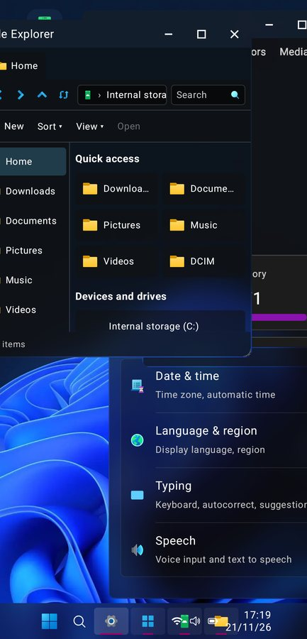
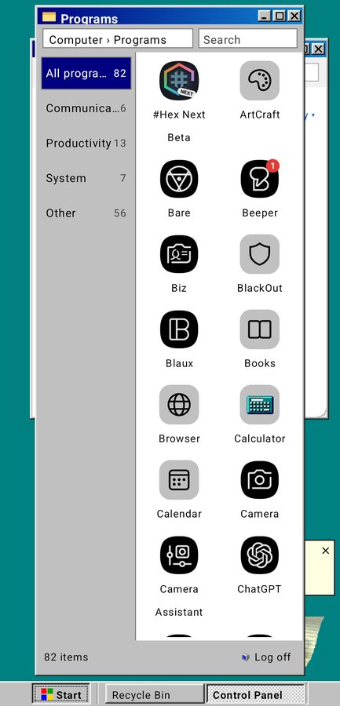
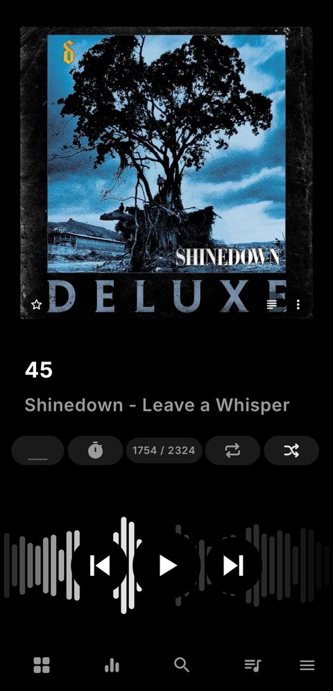
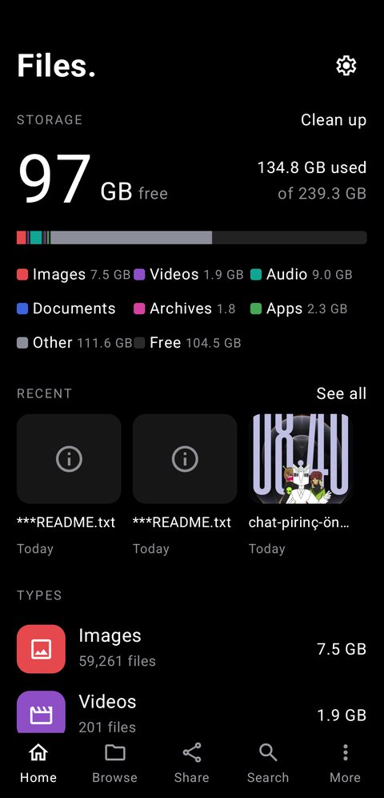

# Pulse — a Windows-style desktop, toolbox and media suite for Android

I have been building **Pulse**, a free and open-source Android app that turns one phone into a Windows-style desktop and an all-in-one toolbox.

The main idea is simple: choose the look you want and get the whole app in that style. Pulse currently includes Windows 95, XP, 7, 10, 11, Windows Phone, Material and AMOLED looks. Screens, dialogs, menus, icons and animations are redrawn for each look, and switching looks takes effect immediately.

## What is included?

- A Windows desktop launcher with real movable, resizable, minimised and maximised windows
- Windows shortcuts such as Win+R, Win+E, Win+Tab, Alt+Tab, Win+Arrow and Win+V
- Windows tools including Task Manager, Control Panel, Device Manager, Event Viewer, Disk Management, Windows Security, Registry Editor, Command Prompt and Terminal
- A music player with Material, Poweramp, Winamp and Windows Media Player-style skins, lyrics, playlists, equalizer, widgets and visualizers
- A video player with online subtitle search
- Files, Photos, Calendar, Contacts, Messages, Notes, Paint, Office, a code editor and a browser
- Game Hub with a 3D box shelf, CD shelf, Chess, Checkers and Power of 4
- A screen cover with clocks and charging animations
- A toolkit with QR/barcode scanning, calculator, compass, level, DNS tools, screenshots, floating timer and more
- Device monitoring for CPU, memory, storage, network, GPU, battery and temperature
- Battery health measurements, app management and debloating with root
- A configurable keyboard with translation, clipboard history, emoji, symbols and PC keys
- Health tools, a gym library, Galaxy Buds controls, Wear OS management and on-device AI
- Home-screen widgets for monitoring, battery, storage, network, temperature, clocks and players

## Links

- **Website:** https://xumutkx.github.io/Pulse/
- **Source code:** https://github.com/xUmutKx/Pulse
- **Download:** https://github.com/xUmutKx/Pulse/releases/latest
- **Tour video:** https://github.com/xUmutKx/Pulse/blob/main/docs/media/Pulse-long.mp4

Pulse is licensed under **GPL-3.0**. It has no ads and does not require an account. Some features need Android permissions, root or Shizuku, but the basic desktop, tools and media features work without root.

Feedback, bug reports and suggestions are welcome. I would especially like to hear which Windows look you would use as your daily launcher.
