# Pulse: A complete Windows-style Android desktop with 95, XP, 7, 10, 11 and more

**Project:** https://github.com/xUmutKx/Pulse

**Latest release and direct download:** https://github.com/xUmutKx/Pulse/releases/latest

**Website:** https://xumutkx.github.io/Pulse/

**Licence:** GNU GPL-3.0

I have been building **Pulse** for years, starting with the tools I wanted on my own Android phone and turning them into one large, consistent app. It is a **Windows-style desktop, system monitor, toolbox, media suite and collection of standalone extra apps**.

Pulse is free and open source, has no account requirement and contains no ads in the FOSS build. There is also a Google Play build. The Android app is written in Kotlin with Jetpack Compose.

You do not need to use every feature. Pulse can be a launcher, a task manager, a file browser, a music player, a keyboard, a weather app or simply a collection of tools. The features below are included in the app rather than being promised for a future release.

---

## One app, every look

Every screen, menu, dialog, button, icon and animation is drawn for every look. Changing the look does not require a restart.

- Windows 11
- Windows 10
- Windows 7
- Windows XP
- Windows 95
- Windows Phone
- Material You
- AMOLED
- One UI and ColorOS styles where they fit

The Windows looks have their own title bars, borders, taskbars, Start menus, icons, boot screens, sign-in screens, desktop icons, wallpaper handling, window controls and click or startup sounds. Windows 11 includes Mica-style surfaces and multiple Fluent icon packs. Windows 95, XP and 7 use period-style bevels and frames, while Windows 10 and 11 have the controls expected from their respective desktop versions.

The AMOLED option is truly black, including the window, root and content backgrounds. Dark Windows looks remain dark instead of falling back to an incorrect Material surface.

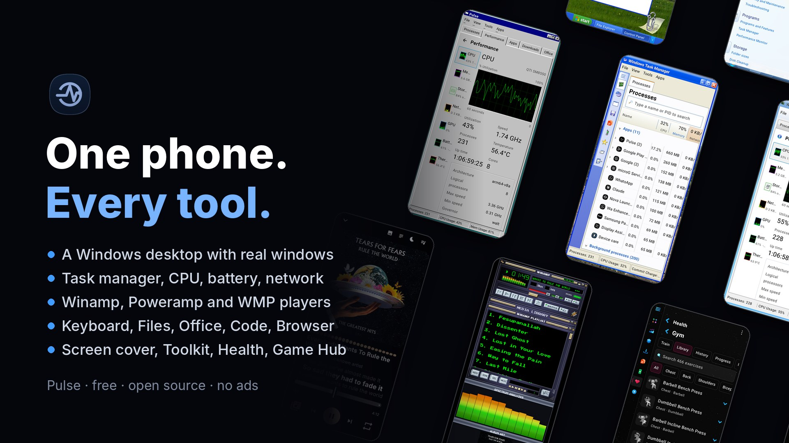

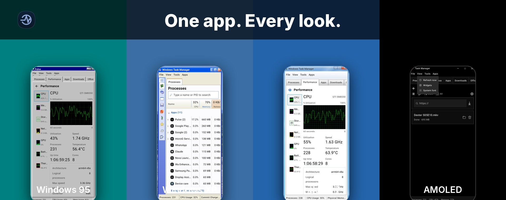

---

## Windows 11, 10, 7, XP and 95 desktop launcher


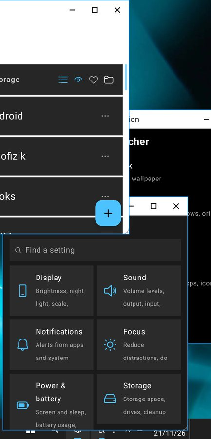

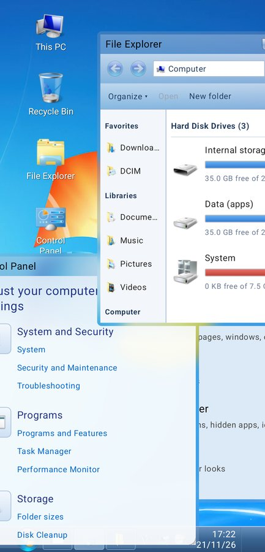

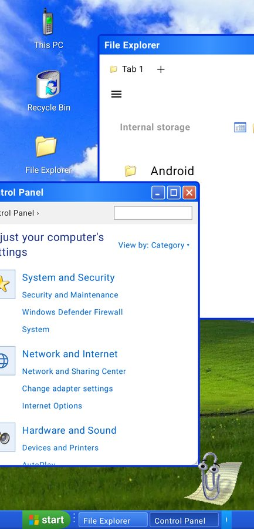


Pulse can replace or accompany the phone launcher. The Windows launcher is a real desktop made in Compose, not a wallpaper with an app grid.

- Desktop shortcuts for This PC, Recycle Bin, File Explorer, Paint and Command Prompt
- Shortcut creation, hidden-app management and optional shortcut arrows
- Movable, resizable, minimisable and maximisable app windows
- Snap a window to the left or right half of the screen
- Selected windows come to the front when the title bar, body or taskbar button is tapped
- Taskbar and tray layouts drawn for the selected look
- Alt+Tab and Win+Tab window switching
- Win+arrows for window snapping
- Win+Left, Right, Up and Down desktop behaviour
- Start menus with search, pinned apps and a complete app list
- Desktop app grid, folders and links to files or folders
- Widgets, wallpapers, dimming and blur
- Icon packs and the look's own mouse/cursor behaviour
- Desktop open animations and look-specific startup and click sounds
- Optional Windows boot and sign-in screens

Pulse supports many physical keyboard shortcuts:

- **Win:** open Start
- **Win+X:** open the system menu
- **Win+R:** open Run
- **Win+E:** open File Explorer
- **Win+I:** open Settings
- **Win+S:** open search
- **Win+D:** show the desktop
- **Win+L:** lock the phone
- **Win+M:** minimise
- **Win+A:** open Action-style controls
- **Win+V:** clipboard history
- **Win+Tab:** open window cards
- **Win+Shift+S:** screenshot
- **Win+/:** shortcut guide
- **Alt+F4:** close the active window
- **Ctrl+Esc:** open Start
- **Esc:** close the active menu or window

When Pulse is the home app, the physical Windows key is handled before some device launchers can consume it. A Pulse screen-cover accessibility layer is needed on some devices.

---

## Windows tools

Pulse includes tools that present and control the phone through familiar Windows interfaces.

- Task Manager
- Processes
- Performance graphs
- Services
- Startup apps
- App history
- Registry Editor
- Device Manager
- Event Viewer
- Disk Management
- Windows Security
- Task Scheduler
- Windows Update for Pulse updates
- Control Panel
- Run box
- Command Prompt
- Terminal
- Recycle Bin
- File Explorer
- Paint
- Error-style dialogs
- Volume and brightness displays

The Run box understands commands including:

- `cmd`
- `terminal`
- `regedit`
- `devmgmt`
- `eventvwr`
- `diskmgmt`
- `taskschd`
- `control`
- `calc`
- `notepad`

The Command Prompt can show Neofetch with the logo of the selected Windows look. Terminal uses the Android robot and has a transparent style.

Control Panel includes search and pages for Wi-Fi, Bluetooth, airplane mode, Do Not Disturb, dark mode, screen timeout, text size, battery saver, lock-screen lyrics and date/time. Some hardware controls use Shizuku or root where Android requires elevated access.

---

## Task manager and live system monitoring

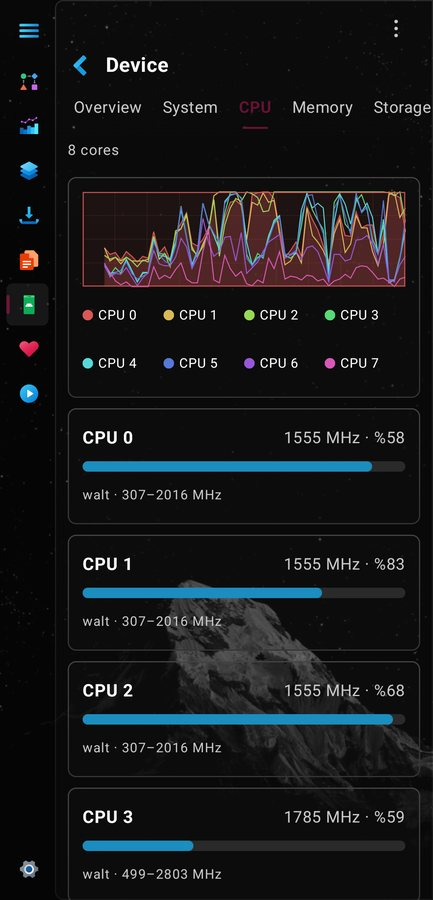

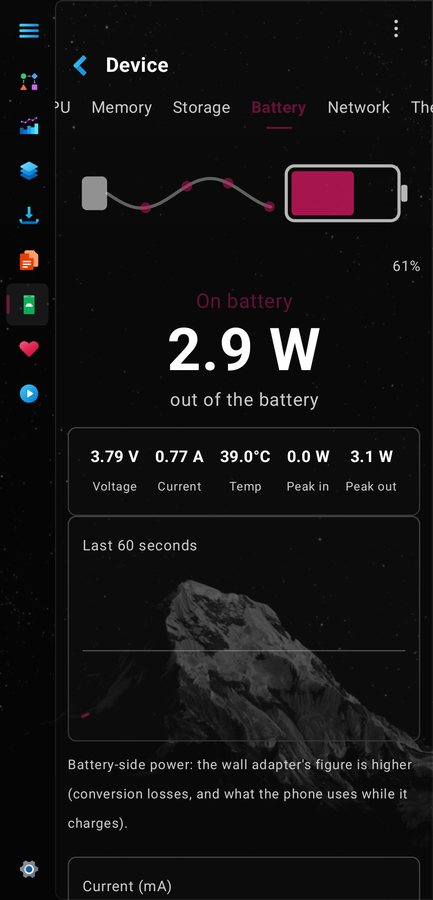

The system tools provide live phone information:

- CPU use
- Per-core frequency and governors
- Memory use
- Storage use
- Wi-Fi and mobile network use
- GPU information
- Battery level and charging state
- Temperature and thermal zones
- Device information
- Display details
- Cameras
- Sensors
- Media and DRM
- System properties
- Short benchmark
- Network latency test
- Processes with CPU and memory use
- End-task controls
- Service inspection
- Startup applications
- App history
- Foreground time per app
- Screen unlock count
- Notification count

Performance pages have live graphs for CPU, memory, storage, network, GPU, battery and temperature. Thermal, battery, storage and memory pages include summaries and 30-minute graphs.

### Battery

- Battery health and reported condition
- Charge cycles
- Reported capacity
- Capacity measured from Android's charge counter while charging or draining
- Current, voltage and power
- Charging power estimates
- Battery alerts
- Quick Settings controls
- Battery widgets

### Floating and background monitoring

- Floating monitor over other apps
- Live notification numbers
- Temperature alerts
- Battery alerts
- Memory alerts
- Configurable alert limits
- Quick Settings tiles
- Watchdog checks every 15 minutes
- Restart of stopped monitor or download work

---

## Processes, app management and debloating

Pulse has an app manager and debloater for experienced users.

- Search, filter and sort installed apps
- Sort by name, size, install date or last use
- Open apps
- Open Android app settings
- Force stop apps
- Uninstall apps
- Extract APK files to `Download/Pulse/extract`
- Filter user, system, disabled, battery-limited and Xposed apps
- Remove system apps
- Reinstall removed apps
- Undo the latest removal
- Offline safety list bundled in the app
- Downloadable updated Universal Android Debloater data
- Safe, Expert and Unsafe markers
- Short descriptions of what debloat candidates do

Removal is only for the current Android user. App data is retained, and the Reinstall page can restore removed apps.

Root unlocks more controls. Shizuku can handle startup switches, force-stop, terminal commands and some silent operations. Pulse remains useful without root or Shizuku.

---

## Files


Pulse Files is a standalone extra app with its own look and launcher entry.

- Folder browser
- Folder tree
- File search
- ZIP support
- 7Z support
- RAR support
- Browse and extract archives
- Compress to ZIP or 7Z
- Copy, cut and delete in a full archive view
- Paste files into a ZIP
- Root browsing
- Browse `/data/data`
- App icons for installed apps
- Save shared files
- Save-as panel
- Recent files
- Recycle Bin
- Large-file finder
- Duplicate-file finder
- Storage type breakdown
- Cached media previews
- Image and media tools
- Compress and convert images
- GIF tools
- APK, APKS, APKM and XAPK installer
- Downloads with multiple connections
- Bulk delete
- Swipe actions
- Cache cleaner
- SD Maid-style expendable rules
- Folder sizes
- Archive crash recovery

Standalone Files can use a separate look and does not overwrite Pulse's main look setting.

---

## Photos, Calendar, Contacts, Messages and Notes

The extra apps are separate launcher entries with separate look stores.

### Photos

- Browse pictures
- Standalone app launcher
- Built-in look system
- Open and share image links
- Separate app settings

### Calendar

- Calendar view
- Standalone calendar app
- Separate look
- Open calendar links directly

### Contacts

- Contact browser
- Standalone launcher entry
- Separate look
- Callable and editable contact links

### Messages

- SMS and MMS
- Default-SMS support
- Reply from notifications
- Read and copy verification codes
- Conversation bubbles
- Attachments
- Mute conversations
- Pin conversations
- Block senders
- Undo send
- SMS signature
- Automatic spam blocking
- Separate Windows 95, XP and 7 message styles

### Notes

- Text lists
- Drawings
- Paint-style drawing toolbar
- AMOLED-black default
- Voice recorder
- Screen recorder
- Notification history
- Standalone launch entry

---

## Office and document editing

Pulse includes Word-, Excel- and PowerPoint-style document support.

- Open and edit Word documents
- Open and edit Excel sheets
- Open and edit PowerPoint presentations
- PDF support
- Home ribbon
- Status bar
- Zoom controls
- Office 95 and 2003-style menus
- Flat Office 2013 and 365-style ribbons
- Solid grey Office 365 window
- Windows 95 through Windows 11 document frames
- Material and AMOLED document frames
- Text editing
- Plain text save
- Preserve existing file behaviour
- Notepad-style text editor
- Remembered black AMOLED text-editor mode

The Office Assistant/Clippy is available in relevant Windows 95 and XP views.

---

## Paint and code editor

Paint-style drawing tools include:

- Pencil
- Brush
- Eraser
- Fill
- Colour picker
- Line
- Rectangle
- Ellipse
- Classic 28-colour palette
- Line width
- Undo
- Open image
- Save to `Pictures/Paint`

The browser and code editor include a terminal-oriented and desktop-oriented interface with a text editor, file navigation and syntax tools.

---

## Music player


The music player has four major interface styles:

- Material
- Poweramp
- Classic Winamp
- Windows Media Player style

The player includes:

- Local music scanning
- M3U and M3U8 playlists
- Save and restore playlists
- Queue management
- Album and artist browsing
- Genre and mood mixes
- Most-played and recently played lists
- Recently added songs
- Stars and favourites
- Shuffle and repeat
- Sleep timer
- Equalizer
- Genre equalizer presets
- Crossfade
- Lyrics search
- Synced lyrics
- LRC support
- Search lyrics by text
- Edit tags
- Album-art search
- Offline album-art storage
- Bluetooth playback controls
- Playback after headset or USB-DAC connection
- Pause on disconnect
- Pause on unplug
- Media notification
- Notification cover art
- Notification lyrics
- User-ordered notification buttons
- MediaStyle controls
- Audio output switching
- Playback speed
- Rewind and forward
- Bluetooth, headphone and USB device handling
- Album-cover waveform seeking
- Live audio level display
- Song recommendations

### Material player

The Material now-playing page is a draggable sheet over the library. Lyrics open over the cover and the app colour fades from one album cover to the next.

### Poweramp player

- Full-screen cover backdrop
- Optional pure black backdrop
- Centre play button
- Previous and next controls
- Waveform seek bar
- Rotary sleep timer
- Sleep from 0 to 120 minutes
- End-of-track timer
- Favourite and tag controls

### Winamp player

- Classic Winamp-style window
- Skin selection
- Skin previews
- Song title in the player skin
- Lyrics inside the title area
- Classic playlist window
- Equalizer window
- Visualizer bars
- Falling visualizer behaviour
- Visualizer home-screen widget

The music player has widgets for Winamp, Winamp visualizer, Poweramp and a plain player. Widgets include real player dimensions and a usable cold-start queue. Player widgets open their skin or now-playing view rather than a cropped partial window.

### Lyrics

Lyrics can be searched by song title or text, matched through LRCLIB and cached locally. Synced text is highlighted while the track plays and saved lyrics can be kept as LRC or text.

---

## Video player

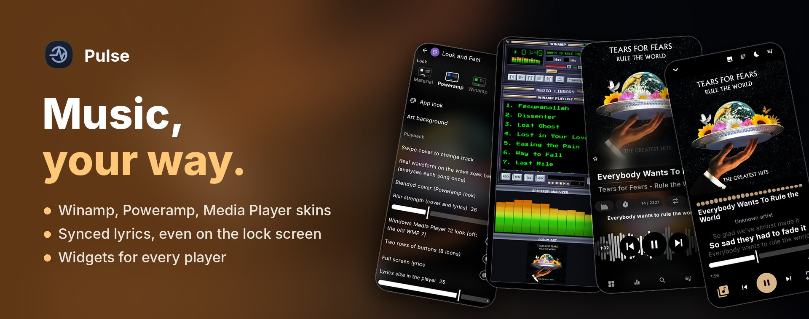

Pulse includes a Media3-based internal video player.

- Video playback
- Full-screen view
- Picture-in-picture
- Subtitles
- Subtitle search
- Subtitle selection
- PIP subtitle support
- Intro and recap skipping
- Yify subtitles search with no account or key
- IntroDB integration
- Landscape and portrait handling
- Audio-only mode for shared music
- Shared download support
- Media notifications
- Background playback

The video player is intended to fit with the same player-skin and look system used by the rest of Pulse.

---

## Game Hub

Game Hub has its own 3D and classic game views.

- 3D box shelf
- Console-case style
- Steam, PS5, Switch, Xbox and similar shelf styles
- CD jewel-case shelf
- Classic grid
- Installed games
- Web games
- Built-in games
- Hidden-game list
- Optional native Rust and wgpu shelf
- Cover images loaded on demand

### Built-in games

- Chess
- Checkers
- Power of 4 / Connect 4
- Four computer difficulty levels
- Two players on one phone
- Two players over Bluetooth
- No internet required for local Bluetooth games
- Logos and frames drawn for the selected look

---

## Screen cover

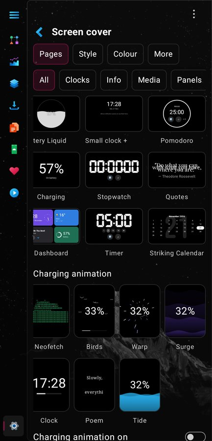

The screen cover is a black overlay for charging, a desk or an always-on display.

- Clock
- Date
- Battery
- Custom text
- Six clock styles
- Clock previews
- Nine screen positions
- Horizontal and vertical positions
- Charging animations
- Dozens of clock and charging layouts
- Motion effects
- Swipe gestures
- Pull-up and pull-down motion
- Advanced cover
- Lock-screen notes
- Sideways desk display
- Optional opening while charging

It can be used to keep an AMOLED screen readable with minimal bright content.

---

## Toolkit

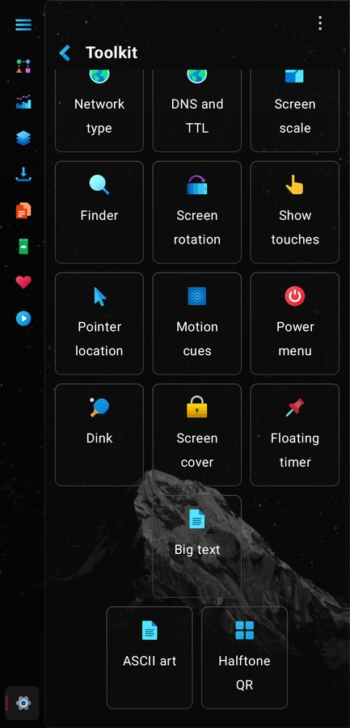

Pulse's Toolkit has dozens of everyday tools.

- QR reader
- Barcode reader
- QR, Data Matrix and Aztec
- PDF417
- EAN
- UPC
- Code 128
- Code 39
- Code 93
- ITF
- Codabar
- Light-on-dark code support
- Quick Settings QR tile
- Floating timer
- Floating controls
- Auto clicker
- Compass
- Level
- Flashlight
- Lux meter
- Dice
- Coin flip
- Clipboard
- Screenshot
- Stopwatch
- Timer
- Rotary timer dial
- Calculator
- Scientific calculator in landscape
- Graph in very wide layouts
- Side-by-side keys
- Network type
- DNS
- TTL
- Private DNS
- Finder
- Power menu
- Screen scale
- Sound mode
- Volume controls
- Screen rotation lock
- Touch display
- Pointer-location display
- Sensors

Pulse includes a live network, DNS and TTL tool. Private DNS can be set to Auto, Off or a manual hostname with root or Shizuku.

### Motion cues

The motion-cues tool helps with motion sickness by displaying a field of dots that stays fixed in the world while the phone moves.

- Sensor-fusion motion input
- Acceleration and tilt
- Turning and orientation
- Clear central area
- Optional pass-through touches
- Adjustable dot field
- Sensor-based road or vehicle cues

The implementation is adapted from the GPL-3.0 Motion cues project by David Ventura.

---

## Keyboard

Pulse also has a complete custom Android keyboard.

- Themes for every look
- Brightness controls
- RGB light effects
- One-handed mode
- Resizable layout
- Split keyboard
- Number pad
- Phone input pad
- Learning autocorrect
- Turkish autocorrection
- Turkish word endings
- Apostrophe handling
- Personal typos
- Word-pair learning
- Whole-sentence context
- Touch-model suggestions
- Training and correction statistics
- Key-heat map
- Multiple keyboard effects
- Color wash
- Per-key tint
- Blob and glass effects
- Glow
- Pop animation
- Sink animation
- Bounce animation
- Retro, calm, fun, pink and space key sounds
- Translation bar
- Language swap
- Inline translations
- English and Turkish
- Long-press accents
- Long-press symbols
- Long-press emoji variants
- Compact bottom row
- Top-row and bottom-row brightness
- Shift outline, underline and filled states
- Caps lock
- Emoji search
- Kaomoji
- Unicode symbol browser
- Symbol search by name
- Clipboard history
- Clipboard pins
- Clipboard images
- Inline translation
- Extra Ctrl, Alt, Win, Shift, arrow and F-key row
- Shift plus key for extra characters
- Email suggestions
- Domain suggestions
- OTP suggestions
- Word suggestions
- Sentence-start suggestions
- Voice and dictation tools
- Key vibration and touch feedback

The keyboard language model can run in Rust for faster suggestions, with Java code retained as a fallback.

---

## AI and on-device tools

Pulse includes on-device AI features:

- llama.cpp chat
- Whisper.cpp transcription
- Whisper.cpp timed lyrics and speech text
- Models found inside Download/PulseAI
- Pulse's own model picker
- Offline OCR
- Reading text and calculator sums from photos
- Neural network keyboard model
- Capitalisation and punctuation correction
- AI text fixing
- AI correction settings
- Vision model fallback

Models can be located anywhere on the phone and selected through Pulse's own folder picker.

---

## Health and fitness

The Health section includes a gym and fitness catalogue.

- 466 exercise entries
- Two-frame exercise art
- Workout recording
- Sets
- Kilograms
- Repetitions
- Rest timer
- Vibration and sound
- Workout routines
- Workout history
- Estimated 1RM
- Weekly volume
- Body measurements
- Food catalogue
- Kilocalorie targets
- Workout summary
- Motion cues
- Step counter
- Heart-rate reading through the camera flash
- Location tracking
- Optional tracking only while enabled

---

## Weather

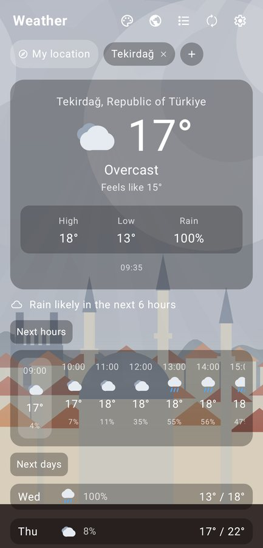

- Weather forecasts
- Saved places
- Location chips
- Sun and moon times
- Sun arc
- Moon phase
- Weather alerts
- Background-free weather widget
- Clock widget
- Weather and clock combined display

---

## Galaxy Buds and Wear OS

Pulse includes a Buds and watch device manager.

### Galaxy Buds

- Earbud battery
- Which earbud is in the ear
- Noise control
- Motion-based noise control
- Touch controls
- Equalizer
- 360 audio
- Find earbuds
- Pause music when earbuds are removed

### Watch manager

- Wireless debugging connection
- Install APKs
- Install Pulse Watch
- Send files
- Take screenshots
- 30-second screen recording
- Open a shell
- Read logcat
- List watch apps
- Open watch apps
- Pull APKs from the watch
- Disable watch apps
- Remove watch apps

Pulse Watch is a Wear OS app with small watch-friendly applications for a round screen.

---

## Extra apps

Pulse treats many features as standalone apps with the same shared controls. Extra apps include:

- Files
- Photos
- Calendar
- Contacts
- Messages
- Notes
- Music
- Video
- Weather
- Paint
- Office
- Code editor
- Browser
- Game Hub
- Clock
- Calculator
- Health
- Screen recorder
- Voice recorder
- Notification history

Each standalone extra app has:

- Its own launcher entry
- Its own look store
- Material as the default look for extra apps
- No shared write to the main Pulse look setting
- The app's look applied before the first frame
- No startup splash animation
- Restoration of Pulse's look after the extra app stops
- An entry under the top-right **Apps** menu
- Entries in Settings under Extra apps
- Optional launcher switching

Extra apps never mix their look with the main Pulse app. A Windows 95 Files window will not accidentally turn the main Pulse desktop into Windows 95 if Pulse's selected look is AMOLED.

---

## Wallpapers and widgets

Pulse includes Windows 95, XP, 7, 10 and 11 wallpaper choices, a wallpaper picker and per-look wallpapers.

- Wallpaper dimming
- Wallpaper blur
- Crop and position controls
- Live preview
- Per-look wallpaper memory
- Windows 11 Mica and acrylic choices
- Windows 10, 7, XP and 95 specific images

The home widget page displays every widget live in the selected look.

Pulse includes more than 20 monitoring and gadget widgets:

- Battery
- Memory
- Storage
- Network
- Temperature
- Clock
- Downloads
- CPU
- GPU
- Music
- Winamp
- Winamp visualizer
- Poweramp
- Plain media player
- Search
- Weather
- System

Widgets can be resized, previewed before adding and arranged in folders or the launcher.

---

## Updates and privacy

Pulse checks GitHub for an update no more often than every 12 hours. The update dialog shows release notes and a direct APK download option.

You can start an update check from Settings. The app can:

- Download APK updates
- Show release notes
- Create crash reports
- Save crash reports under `Download/Pulse/Crash`
- Share the device details and last crash text
- Open Android package installation

Pulse uses no account and does not require an account to use the app. Internet is only needed for features such as downloads, subtitle search, weather, album art, the debloat list and update checks.

Pulse asks for permissions only for the features that need them:

- Usage access
- All-files access
- Display over other apps
- Notifications
- Notification access
- Install unknown apps
- Internet
- Biometrics
- Camera
- Activity recognition
- Location
- Termux command access
- Package queries

Most permissions are optional.

---

## Root and Shizuku

Pulse works without root.

Root unlocks:

- Full process and kernel data
- Temperature zones
- Running services
- Startup app switches
- Cache trimming
- Screenshot tools
- The root tab in Files
- Silent install
- App-data restore
- Downgrade packages while keeping data
- System-app debloating

Shizuku can run the same shell commands for:

- Startup switches
- Killing and force-stopping apps
- Terminal commands
- Silent installs
- Private DNS

Without root or Shizuku, Pulse still provides memory, battery, storage, network, device information, sensors, downloads, files, tools, widgets and the floating monitor.

---

## Release formats

Pulse releases Android APK variants for:

- Full/FOSS
- Lite
- 32-bit
- Google Play
- ARM64
- Tablet and phone layouts

FOSS builds contain no advertising SDK. The project uses a fixed public signing key for reproducible GitHub and Test/Termux builds. Users publishing their own builds should use their own signing key.

---

## Supported languages

Pulse follows the system language by default. English and Turkish are directly selectable in the About screen.

---

## Licensing

Pulse's own code is released under **GNU GPL-3.0**.

Third-party code and resources keep their own licences. Included projects and lists may use GPL-3.0, Apache-2.0, MIT, CC0 or Creative Commons assets. Third-party licences are recorded in `THIRD_PARTY.md` and in the app's licence assets.

Notable components include:

- Media3
- llama.cpp
- whisper.cpp
- Jetpack Compose
- Universal Android Debloater lists
- SD Maid SE rules
- Motion cues
- WattFlow
- XP icon artwork
- Microsoft Fluent System Icons
- GalaxyBudsClient protocol notes
- YTXTube
- NewPipeExtractor
- SponsorBlock
- KMP Odd Scroll / CD Rack
- GymMane
- Lucid Alarm
- Boxshelf
- Shizuku
- Relay

---

## Frequently asked questions

### Is Pulse a launcher, a theme or a normal app?

It is a complete app that can also become the Android home screen. Pulse can run normally alongside the device launcher, or it can replace the launcher when you want a Windows desktop as the home screen. The launcher, settings, system tools and extra apps are all native Android screens made with Compose.

Extra apps can be set as defaults for supported file or link types. Each extra app keeps its own look store, so opening Files or Photos does not change the look of the main Pulse desktop.

### Does the desktop require a PC or Windows?

No. The desktop is drawn entirely on the phone. It does not require a Windows licence, another computer, a virtual machine or a remote desktop connection. The interface uses Android touch, physical keyboard, sensors and permission APIs for its tools.

### Does Pulse work without root?

The main desktop, task manager summary, files, music, video, office tools, weather, games, keyboard, screen cover and toolkit do not require root. Root or Shizuku unlock deeper system operations, including process details, services, startup receiver switches, cache trimming, system-app removal, silent installation and some private Android settings.

Pulse never makes elevated access mandatory. Settings pages describe which functions need elevated access and which can remain available with normal Android permissions.

### Does the FOSS build contain ads?

No. The FOSS build contains no advertising SDK or account login. The Google Play build can contain Google Play billing and advertisement integration. Neither build requires a Pulse account.

### Which Android version should I use?

Use the APK variant in the latest release that matches the device's architecture and Android version. Android 12 or newer gives the best look-system, permission and media compatibility. Some protected features depend on the exact phone firmware even with a recent Android version.

### Can Pulse run offline?

Yes. Local files, local music, games, system information, the task manager, the keyboard, calculator, compass, level, flashlight and many tools work offline. Internet is used for album art, weather, subtitle search, update checks, downloads, the debloat list and online APIs.

### Can Pulse replace the Android settings app?

It includes working settings pages for Wi-Fi, Bluetooth, airplane mode, screen timeout, text size, dark mode, battery saver and several protected controls. Android still owns hardware permissions and restricted APIs. Root or Shizuku can unlock commands for more settings, but protected controls remain on the Android system side when elevated access is unavailable.

### Can windows really move and resize?

Yes. Windows have title bars and per-look controls. Dragging a window toward an edge snaps it to a side of the phone. The taskbar button also brings a window to the front. Maximising and minimising follow the selected look. On small screens, layouts are scaled to fit the window instead of being cut outside the frame.

### Is this only a Windows wallpaper?

No. This is a native Android launcher and application suite. Desktop shortcuts open real Pulse pages or Android apps. Task Manager reads live Android process and system data. Registry Editor presents Android settings data in a Windows-style interface. Device Manager presents Buds and watch devices. The other tools have real Android implementations.

### Can I use it only as a file browser or music player?

Yes. All optional app sections can be hidden or moved through Settings. Pulse does not force the Windows desktop to open when a specific extra app is launched. Standalone Files, Photos, Calendar, Contacts and Messages have their own entries and look settings.

### Does it import Poweramp playlists?

Pulse can import and export Poweramp playlist backups. Play counts and favourites can be imported through the supported backup fields. M3U and M3U8 files are found in common Music, Playlists, Download and Documents directories.

### Can the music player play in the background?

Yes. Playback uses Media3 and an Android media notification. Bluetooth, wired headset and USB-DAC connection handling are available. A watchdog can restart media and download work that Android has stopped. Android battery restrictions may still suspend background services if the phone aggressively disables the app.

### Does it support Galaxy Buds?

Pulse has a Buds view for earbud battery, wear state, noise mode and controls. It can stop playback when the earbuds are removed. Available controls vary by Buds model and Android Bluetooth permissions.

### Does it support a Wear OS watch?

Pulse includes a watch manager and Pulse Watch is a Wear OS app. The watch app provides small watch-friendly applications. The phone manager can install apps, send files, capture screenshots, record a short screen video, open a shell and run logcat when wireless debugging is available.

### Can I open Office documents and PDFs?

Pulse includes document windows for Word-, Excel- and PowerPoint-style files. It also includes text editing and PDF reading. Document support depends on the format and Android device. Save important files to a new copy before editing.

### Can I build the source?

The source uses Kotlin and Jetpack Compose. Build requirements include JDK 17 or newer and an Android SDK. The project uses Gradle 8.9 and expects `local.properties` to point to the Android SDK. The project does not commit `local.properties`.

```text
gradle :app:assembleRelease
```

GitHub Actions and the build scripts use a fixed public signing key for test/release chains. Independent publishers should use their own signing key.

### What settings are remembered?

Pulse remembers the look, accent, dark mode, wallpaper, launcher layout, hidden apps, desktop shortcuts, keyboard theme, storage preferences, playback preferences, screen-cover settings and standalone extra-app looks. Each extra app has a separate store and restores its look independently.

### Which features need Android permissions?

Optional permissions include usage access, all-files access, display over other apps, notifications, notification access, install unknown apps, internet, biometrics, camera, activity recognition, location and package queries. Pulse's features explain why a permission is required and can keep working when unrelated permissions are denied.

### What is safe to use as a first test?

Good first features are a look preview, Files, music from the local collection, the screen cover, Task Manager, the Windows desktop, weather and the Toolkit. Then test permissions and elevated features only if needed.

### Where can bug reports and suggestions be sent?

Use the GitHub repository issues page or Settings > Report > Create crash report. A report is easier to reproduce when it includes the device model, Android version, Pulse release name and the exact action that failed.

---

## Technical notes

Pulse is organized around Kotlin, Jetpack Compose and AndroidX components. Many interface elements are rendered as Compose canvases or per-look components instead of Android's default Material controls. This lets the Windows 95 frame use a bevel, Windows 11 use a mica-style surface and AMOLED use pure black while keeping the same feature logic.

The one-look system is the central UI contract. A look resolves its title bar, frame, text, menu, icon, button and window-state colors. Lists and dialogs do not depend on the default `LocalContentColor` in dark themes. Extra apps use separate look providers instead of reading or writing the main app's preferences.

### Architecture

- Kotlin feature packages
- Jetpack Compose UI
- Media3 player components
- AndroidX storage and system APIs
- Native C++ components
- Rust components for selected analysis or shelf features
- Web views for the YTXTube and selected game-hub experiences
- Local SQLite or JSON storage where a feature needs persistence
- MediaStore indexes for local media and files
- Android services for monitoring and playback
- Quick Settings tiles for live tools
- Home-screen app widgets
- Wear OS companion app

This is a monorepo but the standalone extra apps are not simply fragments of the Pulse launcher. They have activity aliases, launch settings, separate look preferences and app-specific entry points.

### App and release variants

The full build includes the complete Android feature set available for the device. A lite build excludes selected large or optional components. A 32-bit build supports older device architectures. The Play build uses Google Play integration where needed. The FOSS build removes advertising SDKs.

Releases can be downloaded from GitHub or installed through supported APK updates and package managers. APK variants are signed consistently for updates. A third-party package may need to use the repository's APK variant or an own signing key if it requires updating over an existing installation.

### Update behaviour

Pulse checks GitHub periodically but does not require a poll in the foreground. Updates are checked no more than every 12 hours. When a newer release exists, the app displays the release notes and offers an installer action.

The in-app update checker and Settings report tools do not replace the Android package installer. Android remains responsible for signature verification, unknown-source permissions and package replacement.

### Storage layout

Pulse keeps project output away from the Android storage root. Shared app data is grouped below `Download/Pulse`, including:

- Shared download files
- AI models and exports
- Crash reports
- Desktop data
- ArtCraft artifacts
- Update downloads
- Pulse backups
- Extracted APK files
- Media exports where the feature provides them

Standalone apps may create their own Android media folders for photographs, voice recordings or drawings. The app explains where a file is saved in the relevant save or share panel.

### Developer data and crash reports

Crash report creation collects the report text and the device details needed to understand the failure. The report is saved locally and can be shared by the user. It is not uploaded automatically.

Bug reports should include:

- Pulse APK name or release version
- Android version
- Device manufacturer and model
- CPU architecture
- The look selected in Pulse
- The exact feature being tested
- Steps that reproduce the issue
- A safe screenshot if the UI is involved
- A short crash report if one was created

Do not post API keys, private addresses or personal clipboard and message content in a public issue.

### Supported code, text and media formats

The app includes parsing and viewing for common document, archive and media formats where the Android device provides the required codec or storage access.

Examples include ZIP, 7Z, RAR, M3U, M3U8, plain text, common Office formats, PDF, common image formats, local audio codecs supported by Media3 and local video codecs supported by the Android media stack.

Codec and subtitle support can vary by device. A missing codec is not a Pulse server outage.

### Accessibility and input

The interface includes keyboard navigation for physical-keyboard users and touch layouts for phones. Look-specific interfaces can have separate icon, mouse and window behaviour. Text size is available as an app setting and follows Android where supported.

The screen cover can include a pass-through or overlay mode for the motion-cues feature. Accessibility and system-overlay permissions are only requested for features that need them.

### Safety limits

Pulse marks debloat candidates with conservative safety levels, but removing a system package can still affect a device. A successful reinstall does not guarantee that every phone vendor allows a removed package to return. Back up important data before deleting system apps.

Root and Shizuku actions are not silently applied. Operations that stop apps, remove packages or change protected settings require the relevant Android, Shizuku or root context.

### No hidden app account

Pulse has no required login for its core features. Sign-in is only used by features that explicitly integrate an external service and can be disabled or separated from the local app. Google account sign-in for integrated external services is not the same as a Pulse account.

### Source contributions

Contributions can update a feature, fix an Android-device variation or add a native/extra-app implementation. Changes should preserve the look contract: every feature needs a complete Windows and Material/AMOLED presentation, not only a default Material screen.

The project is licensed under GPL-3.0, so third-party code must have a compatible licence. Third-party source, assets and licence notices are kept in the repository and app licence files.

### Building safely

Use a separate signing key for a private or published fork. Do not publish private keystones or keys in GitHub issues, README files or screenshots. The public repository signing key is intended for the project's own test/release chain and is not an Android security secret.

Gradle builds should use the Android SDK and JDK versions declared by the project. Android Studio or Gradle can build the APK, but a local build should not remove or change third-party licence declarations.

---

## Screenshots

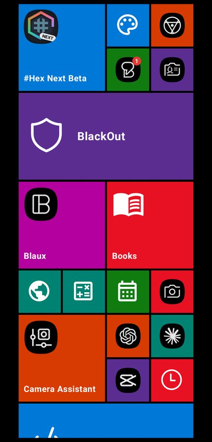

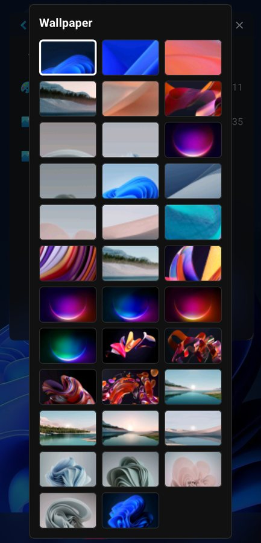

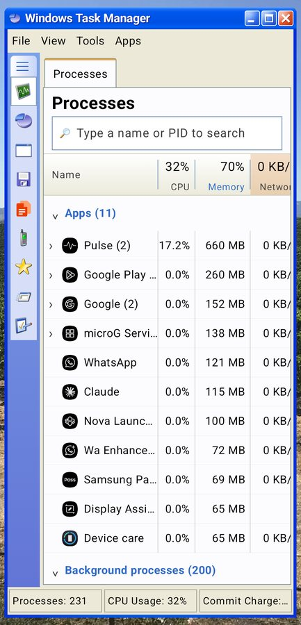

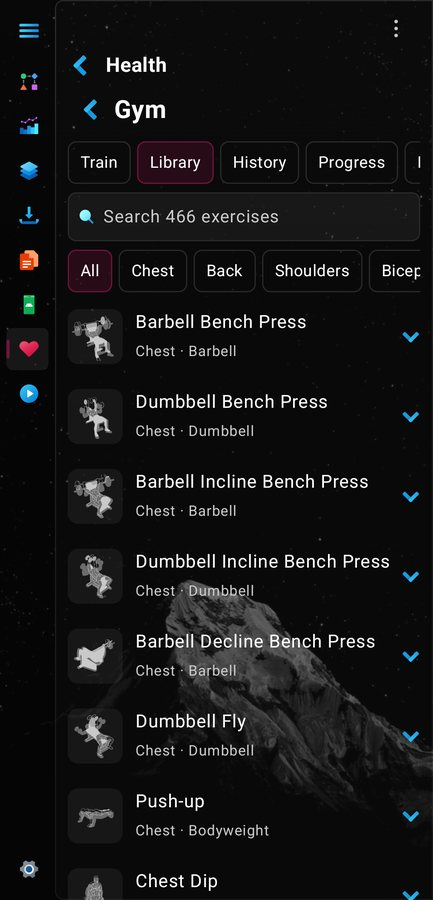

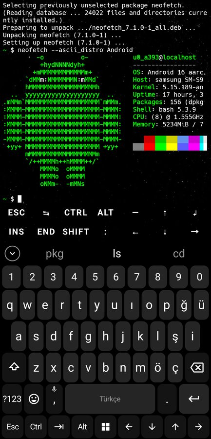

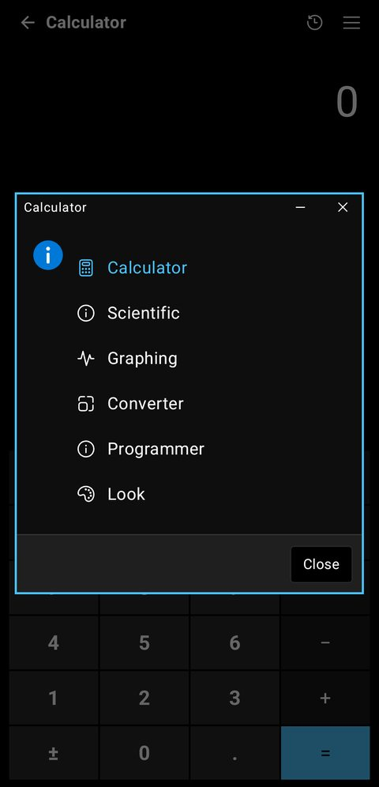

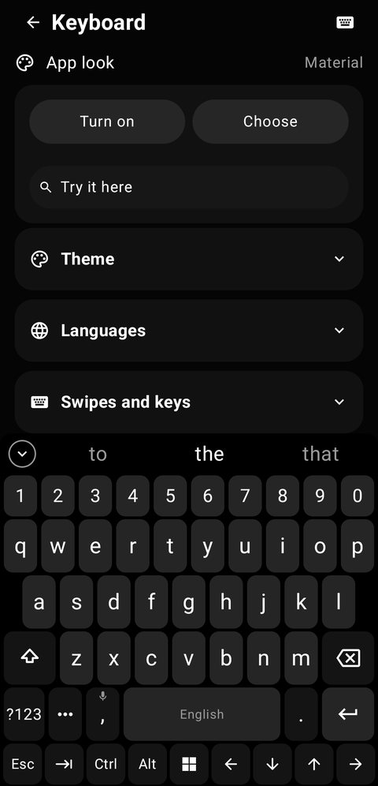

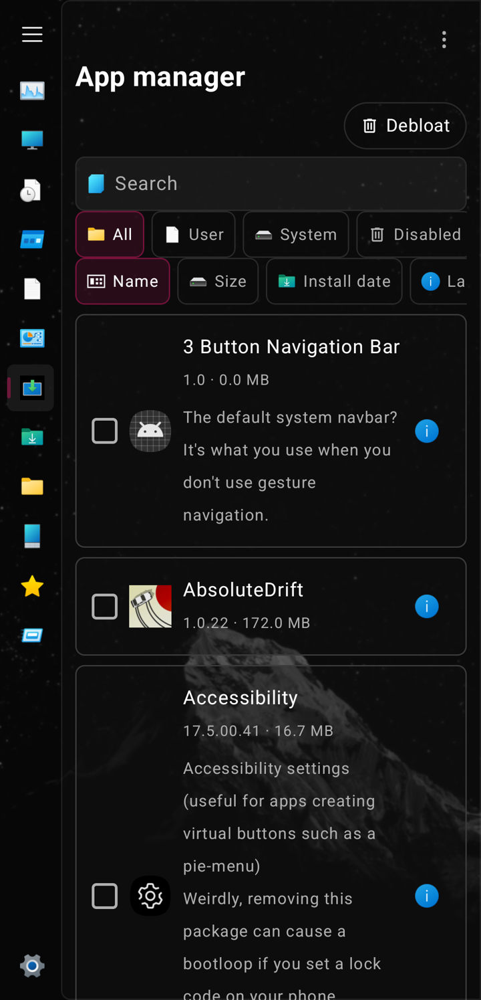

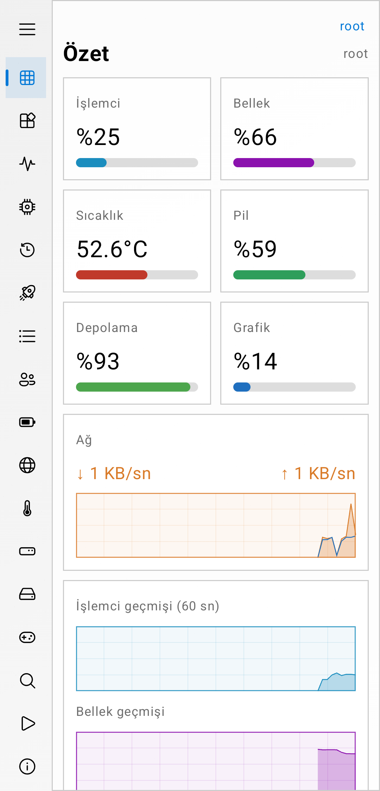

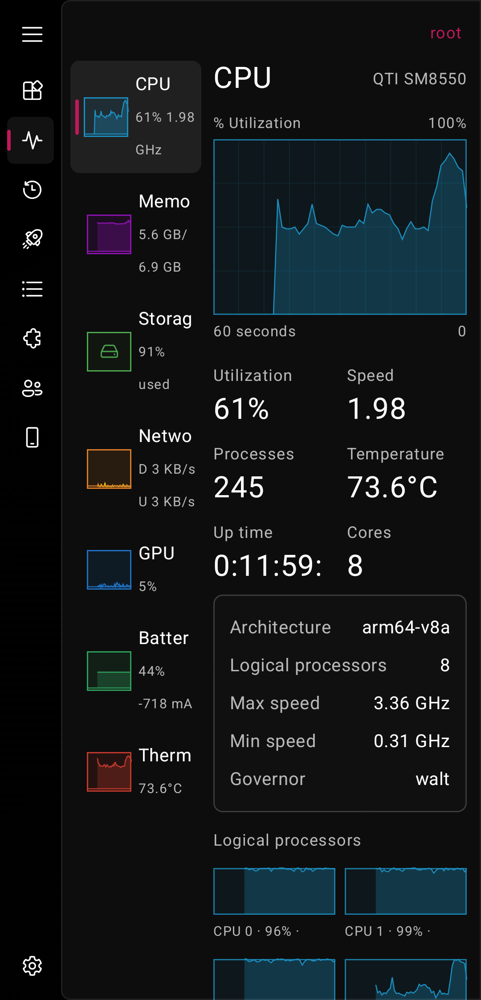

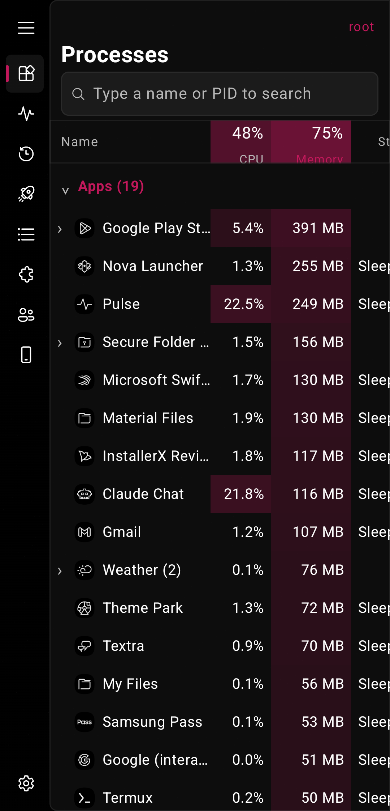

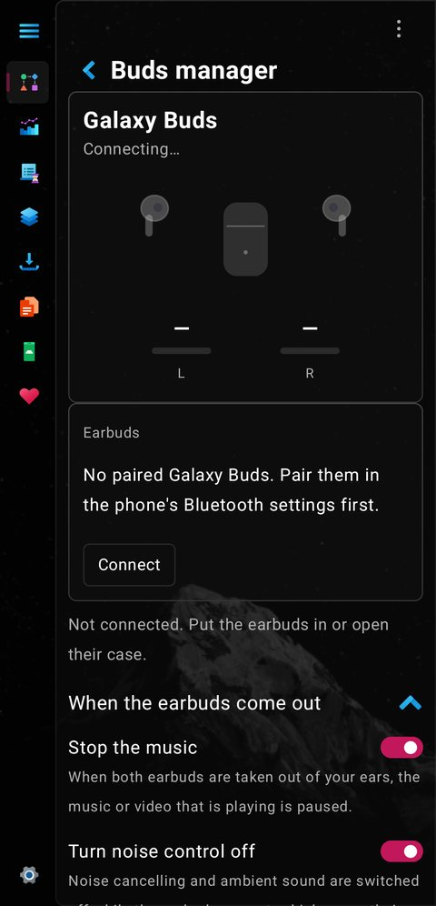

---

## Links

- **Repository:** https://github.com/xUmutKx/Pulse
- **Download latest release:** https://github.com/xUmutKx/Pulse/releases/latest
- **Website:** https://xumutkx.github.io/Pulse/
- **Source licence:** https://github.com/xUmutKx/Pulse/blob/main/LICENSE
- **Third-party licences:** https://github.com/xUmutKx/Pulse/blob/main/THIRD_PARTY.md
- **Tour video:** https://github.com/xUmutKx/Pulse/blob/main/docs/media/Pulse-long.mp4
- **Short video:** https://github.com/xUmutKx/Pulse/blob/main/docs/media/Pulse-short.mp4

Bug reports, feature suggestions and pull requests are welcome. When posting feedback, include the Pulse version, Android version and device model. That makes a bug much easier to investigate.
