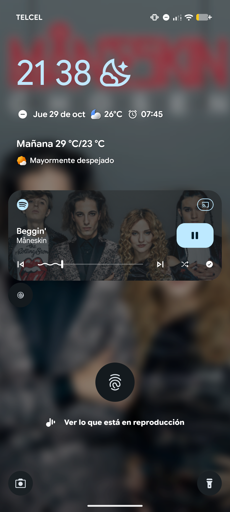
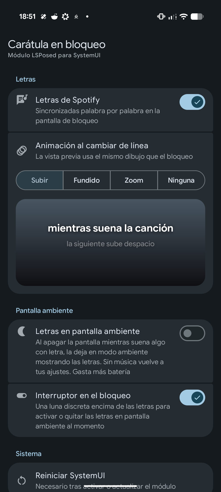
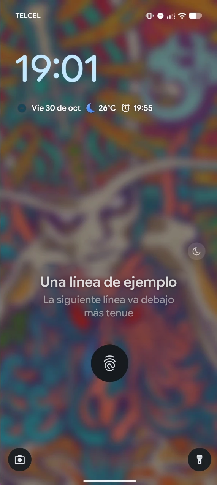
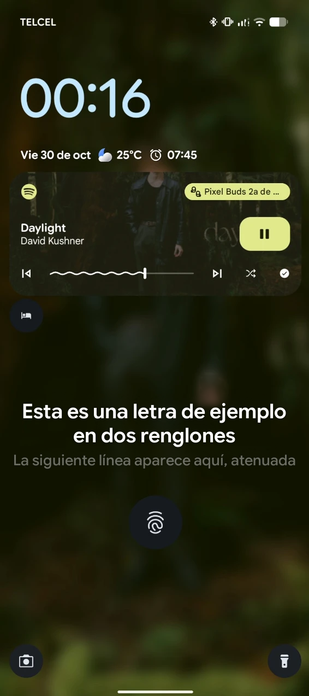
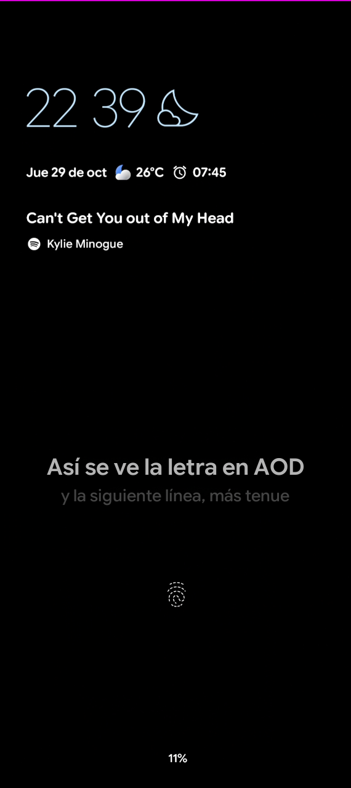
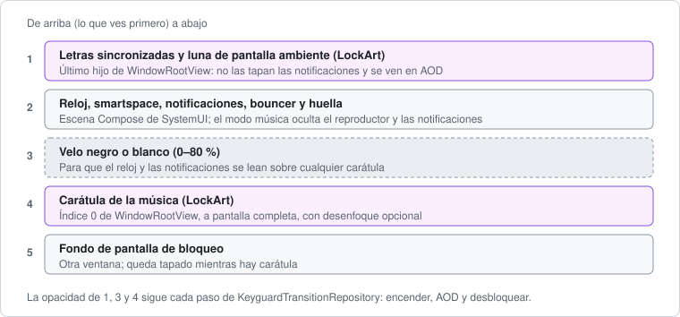

# LockArt · Carátula en bloqueo

Módulo LSPosed que vuelve a mostrar la **carátula de la música a pantalla completa en la pantalla de bloqueo**, como en Android 10 y en las ROMs personalizadas, y añade las **letras sincronizadas de Spotify** en el bloqueo y en la pantalla ambiente. Está hecho para el *Scene Container* de Android 17, donde los mods antiguos ya no funcionan.

<p align="center">
  
  &nbsp;&nbsp;
  
</p>

## Capturas

| Letras en el bloqueo | Con el reproductor | Pantalla ambiente |
|:---:|:---:|:---:|
|  |  |  |
| Modo música: sin reproductor ni notificaciones, con la luna para la pantalla ambiente. | Sin modo música, la letra va bajo el reproductor. | AOD con la canción bajo el reloj y la letra, aunque el AOD esté desactivado en Ajustes. |

*En las capturas, la letra original se reemplazó por texto de ejemplo para respetar los derechos de autor; el resto de la pantalla es tal cual se ve en el teléfono.*

## Qué hace

**Carátula**
- Toma la carátula de lo que esté sonando (Spotify, YouTube Music o cualquier app con sesión multimedia) y la pone de fondo en el bloqueo, debajo del reloj y las notificaciones.
- Sigue fotograma a fotograma la animación real del bloqueo: aparece al encender la pantalla, se oculta en la pantalla ambiente y se desvanece al desbloquear.
- Fundido cruzado al cambiar de canción, y se conserva la carátula de mayor resolución de cada canción.
- Se puede **desenfocar** y cubrir con un **velo** para que el texto se siga leyendo.

**Letras de Spotify**
- Muestra la letra sincronizada de la canción en el bloqueo: la línea actual grande y la siguiente atenuada debajo, con relleno palabra por palabra cuando Spotify trae esos tiempos.
- Cuatro animaciones al cambiar de línea: **Subir** (la anterior sube y la siguiente ocupa su lugar, como una lista), **Fundido**, **Zoom** y **Ninguna**, con vista previa en la app.
- Mientras hay letras se mantiene el reloj pequeño, para que el reloj grande no las tape.

**Mientras suena** (modo música)
- Oculta el reproductor y las notificaciones del bloqueo y pone la canción (título, icono y artista) bajo el reloj. Al bajar el panel, el reproductor sigue ahí para pausar o cambiar de canción.
- Al parar la música todo vuelve a como lo tienes configurado. **No cambia ningún ajuste del sistema**: todo ocurre en memoria dentro de SystemUI.

**Pantalla ambiente**
- Al apagar la pantalla mientras suena algo con letra, la deja en modo ambiente mostrando las letras, **aunque tengas el AOD desactivado**. Sin música vuelve a tus ajustes.
- Se apaga sola cuando la música se detiene, aunque la pauses desde los audífonos u otro dispositivo.
- Se apaga en el **bolsillo** o **boca abajo** (sensor de proximidad y gravedad) y vuelve al sacarlo.
- Un **interruptor discreto** (una luna sobre las letras) la activa o desactiva desde el propio bloqueo.

## Cómo funciona



Ganchos en SystemUI (API moderna de LSPosed, `libxposed` 102):

| Gancho | Para qué |
|---|---|
| `WindowRootView.onAttachedToWindow` | Mete la carátula en el índice 0 de la ventana del bloqueo y las letras en una capa encima de la escena. Sin Scene Container (Android 14–16) usa `NotificationShadeWindowView`. |
| `KeyguardTransitionRepositoryImpl.emitTransition` | Cada paso de transición del bloqueo (de dónde a dónde y en qué porcentaje), para seguir la animación del sistema. |
| `KeyguardMediaViewModel.isMediaVisible` | Oculta la tarjeta del reproductor solo en el bloqueo (modo música). |
| `KeyguardNotificationVisibilityProviderImpl.shouldHideNotification` | Oculta las notificaciones mientras el teléfono está bloqueado (modo música). |
| `LockscreenSmartspaceController.updateMediaTarget` | Pone la canción bajo el reloj; en Android 17 el objetivo de Google ya no llega, así que LockArt lo construye. |
| `KeyguardClockRepositoryImpl.getClockSize` | Mantiene el reloj pequeño mientras hay letras. |
| `AmbientDisplayConfiguration.alwaysOnEnabled` y `DozeMachine` | Activa la pantalla ambiente en memoria y pasa de AOD a pantalla apagada cuando hace falta. |

Y en el proceso de Spotify:

| Gancho | Para qué |
|---|---|
| `MediaSession.setMetadata` | El identificador de la canción que suena. |
| Constructor de `okhttp3.Headers` | Copia las cabeceras de sesión que Spotify ya usa. Spotify ofusca el nombre de la clase, así que se encuentra con **DexKit** y se guarda por versión. |

Con esas cabeceras pide la letra al mismo servidor que la pestaña de letras de Spotify (`color-lyrics`, en protobuf) y se la manda a SystemUI. SystemUI solo acepta letras que vengan del proceso de Spotify (comprueba la identidad del remitente). Los ajustes viven en las preferencias remotas de LSPosed y SystemUI los aplica al momento. Al actualizar el módulo, LSPosed lo **recarga en caliente** sin reiniciar SystemUI.

## Requisitos

- Android 12 o superior. **Probado en un Pixel 9 Pro XL con Android 17** (`CP3A.261005.005`) y Spotify 9.1.90. En otras versiones o ROMs puede que los ganchos no coincidan.
- Root (KernelSU o Magisk) y un LSPosed con la **API moderna 102** (por ejemplo LSPosed 2.2 o superior). Las versiones de LSPosed que solo cargan módulos antiguos no lo verán.
- Para las letras: Spotify y tu sesión iniciada en él.

### Versión de Spotify

Las letras **solo se han probado con Spotify 9.1.90.2270**. No se ha probado en otras versiones: Spotify cambia sus clases internas en cada actualización, y una actualización puede romper las letras hasta que se adapte el módulo. La carátula, el modo música y la pantalla ambiente no dependen de la versión de Spotify.

Para que resista mejor las actualizaciones, LockArt no usa los nombres ofuscados de Spotify, sino «huellas» que no cambian al compilar, como hacen módulos como WaEnhancer:

- **La canción** sale de `MediaSession`, que es de Android y no de Spotify.
- **La clase de cabeceras de OkHttp** se busca con DexKit por tres huellas independientes: el texto que usa `Headers.of`, el texto con el que `toString` oculta valores sensibles y su estructura (un `Iterable` con un campo `String[]`, constructor `(String[])` y un método que devuelve `TreeMap`). Cada candidato se valida antes de usarse, y el resultado se guarda por versión instalada de Spotify.
- **La respuesta del servidor** se lee tanto en protobuf como en JSON, el formato de respaldo de Spotify.
- **Cada función va por separado**: si las letras fallan, lo demás sigue funcionando.

Con cada versión nueva de Spotify, el log dice qué huellas siguen encontrando la clase, así se ve si alguna se rompió antes de que fallen todas:

```bash
adb logcat -s LockArt | grep huellas
```

Se recomienda **evitar que Play Store actualice Spotify automáticamente** con [zygisk-detach](https://github.com/j-hc/zygisk-detach) o un módulo similar, que desvincula la app de Play Store, y actualizarla solo cuando confirmes que la nueva versión funciona.

## Instalarlo

1. Descarga `LockArt-x.y.apk` de la página de [Releases](../../releases) e instálalo:
   ```bash
   adb install LockArt-4.8.apk
   ```
2. En LSPosed, activa **Carátula en bloqueo**. Su alcance es **Interfaz del sistema** (`com.android.systemui`) y **Spotify** (`com.spotify.music`). Si Spotify no queda marcado, la app muestra **Activar en Spotify** y se lo pide a LSPosed.
3. Abre la app y pulsa **Reiniciar SystemUI** (pide root). Cierra y vuelve a abrir Spotify.
4. Pon música y bloquea la pantalla.

Si actualizas desde una versión anterior a la 3.0, reinicia SystemUI una vez. Desde la 3.0 las actualizaciones se aplican solas.

## Ajustes

| Grupo | Ajuste | Qué hace | Por defecto |
|---|---|---|---|
| Carátula | Mostrar carátula | Activa o desactiva la carátula sin desactivar el módulo. | Activado |
| | Desenfoque | De nítida a 25; los primeros niveles son muy sutiles. | Nítida |
| | Velo | Oscurece (o aclara) la carátula de 0 a 80 %. | 25 % |
| | Velo automático | Velo blanco cuando tu fondo de bloqueo pide texto oscuro. | Activado |
| Mientras suena | Modo música | Sin reproductor ni notificaciones en el bloqueo y la canción bajo el reloj. | Activado |
| | Mantener en pausa | No quitar la carátula al pausar. | Desactivado |
| Letras | Letras de Spotify | Letra sincronizada en el bloqueo. | Activado |
| | Animación al cambiar de línea | Subir, Fundido, Zoom o Ninguna, con vista previa. | Subir |
| Pantalla ambiente | Letras en pantalla ambiente | AOD con letras mientras suena algo con letra. Gasta más batería. | Desactivado |
| | Interruptor en el bloqueo | Muestra la luna para cambiar el ajuste anterior desde el bloqueo. | Activado |
| Sistema | Reiniciar SystemUI | Para la primera activación. | — |

## Si algo no funciona

| Síntoma | Causa probable | Qué hacer |
|---|---|---|
| La app dice **SystemUI no responde** | El módulo no está cargado. | Actívalo en LSPosed y reinicia SystemUI. |
| **Cargado, pero sin vista** | No encontró la pantalla de bloqueo. | Reinicia SystemUI. Si sigue igual, tu versión no es compatible. |
| No salen letras | Spotify no está en el alcance o no se reinició. | Pulsa **Activar en Spotify** y vuelve a abrir Spotify. Algunas canciones no tienen letra sincronizada. |
| La pantalla se apaga en vez de mostrar letras | El **ahorro de batería** bloquea la pantalla ambiente. | Desactiva el ahorro de batería o carga el teléfono. |
| Aviso de root al reiniciar | La app no tiene root. | Concédelo en KernelSU/Magisk o reinicia el teléfono. |

Para ver el log del módulo (nunca escribe el texto de las letras):

```bash
adb logcat -s LockArt
```

## Idiomas

La app está en **español** e **inglés**. Usa el idioma del teléfono y, si no es ninguno de los dos, se muestra en inglés. También se puede elegir solo para esta app en *Ajustes > Sistema > Idiomas > Idiomas de las apps*.

## Código fuente

El código está en este repositorio, bajo la licencia [Apache-2.0](LICENSE). Los créditos de las partes adaptadas están en [NOTICE](NOTICE).

| Archivo | Qué hace |
|---|---|
| `LockArtModule.java` | Entrada del módulo (libxposed 102): instala los ganchos en SystemUI y en Spotify y maneja la recarga en caliente. |
| `ArtController.java` | Carátula, velo, sesiones multimedia y letras dentro de SystemUI. |
| `MusicMode.java` | Modo música, reloj pequeño, smartspace y pantalla ambiente forzada. |
| `AodGuard.java` | Apaga la pantalla ambiente en el bolsillo o boca abajo. |
| `LyricsView.java`, `AodToggleView.java` | Dibujo de las letras con sus animaciones y la luna del bloqueo. |
| `SpotifyLyrics.java`, `SpotifyProto.java` | Proveedor de letras dentro de Spotify: huellas con DexKit, petición y lectura de la respuesta. |
| `MainActivity.kt`, `SettingsScreen.kt` | App de ajustes en Jetpack Compose con Material 3 Expressive. |

**Compilar:**

1. Android Studio con JDK 17 o superior y el Android SDK 37.
2. Crea `keystore.properties` en la raíz con tu clave de firma (no se sube al repositorio):
   ```properties
   storeFile=mi-clave.keystore
   storePassword=...
   keyAlias=...
   keyPassword=...
   ```
   Sin ese archivo, la versión release se firma con la clave de depuración.
3. `./gradlew assembleRelease` (o `build.ps1` en Windows, que deja el APK en `build\LockArt.apk`).

La app y el gancho se comunican con un permiso de firma, así que un APK firmado con otra clave no se instala encima del publicado aquí: hay que desinstalar el anterior.

Si quieres adaptarlo a otra versión de Android, otra ROM u otra versión de Spotify, abre un [issue](../../issues) o un pull request.

## Créditos

- La obtención de letras de Spotify está adaptada del proveedor `spotify-music` de [LyricProvider](https://github.com/tomakino/LyricProvider) (tomakino, Apache-2.0).
- Ideas de [SuperLyric](https://github.com/HChenX/SuperLyric) (HChenX).
- Búsqueda de clases ofuscadas con [DexKit](https://github.com/LuckyPray/DexKit) (LuckyPray, LGPL-3.0 / Apache-2.0).

## Aviso

Modifica SystemUI y Spotify en tiempo de ejecución. Si SystemUI se cierra en bucle, desactiva el módulo en LSPosed o arranca en el modo seguro de KernelSU/Magisk. Las letras se obtienen de una API interna de Spotify con tu propia sesión y solo se muestran en tu teléfono; no es un uso oficial y Spotify puede cambiarla en cualquier momento. Las carátulas y las letras pertenecen a sus respectivos dueños. Úsalo bajo tu responsabilidad.
